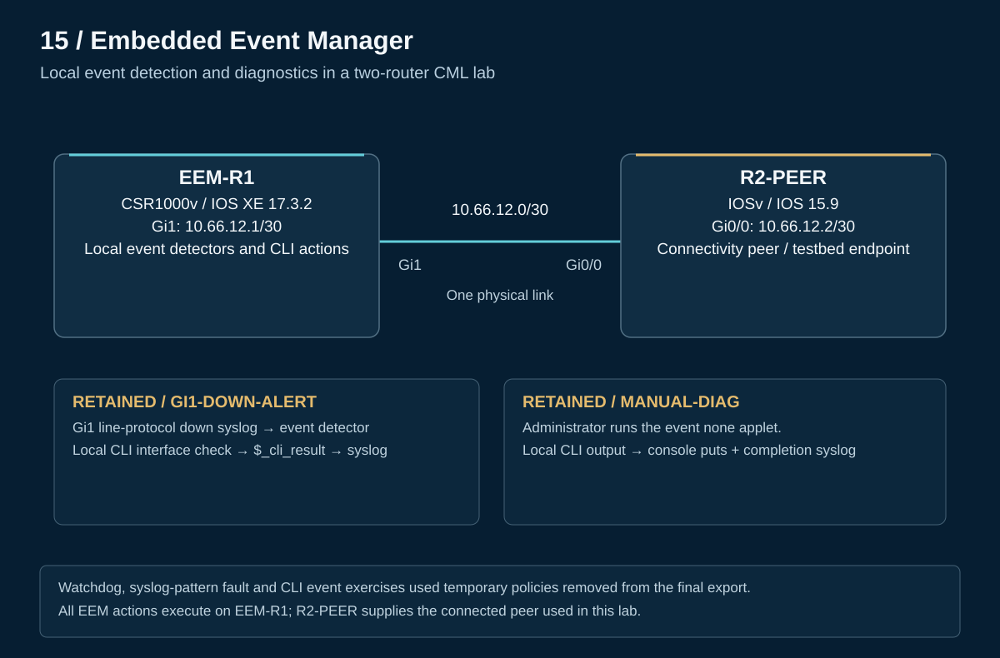

# 15 — EEM: Automated diagnostics and event troubleshooting

I built automation on a Cisco Modeling Labs router to capture interface diagnostics when a test link changed state and to run diagnostics on demand. I then tested recurring timers and CLI event handling, including two cases where a registered policy failed to trigger.

The objective was to turn a device event into useful diagnostic evidence and verify each step: the trigger matched, the applet ran, and its actions produced the intended result. This is a CML exercise aligned with **CCNP ENCOR 350-401 v1.2, objective 6.6 — construct an EEM applet to automate configuration, troubleshooting, or data collection**.

**Quick navigation:** [Results](#recorded-results) · [Topology](#lab-design) · [Process diagrams](operation.md) · [Configurations](configs/README.md) · [Verification](verification/README.md) · [Troubleshooting](troubleshooting/README.md) · [Evidence scope](scope.md)

## Recorded results

| Test | Recorded outcome |
|---|---|
| Automatic alert and CLI capture | A controlled interface shutdown produced the custom alert and a diagnostic showing `administratively down down` |
| Manual diagnostics | `event manager run MANUAL-DIAG` displayed interface information and logged completion |
| Recurring watchdog | Three recorded triggers were approximately 60 seconds apart |
| Syslog detector repair | Matching the actual `%LINK-5-CHANGED` message restored the temporary fault-test trigger |
| CLI event handling | A revised pattern triggered asynchronously; the later synchronous policy allowed `show clock` to proceed |

The final saved applets are **GI1-DOWN-ALERT** and **MANUAL-DIAG**; watchdog, fault-test, and CLI-audit applets were removed after testing. The [verification guide](verification/README.md) distinguishes selected CLI excerpts from reported observations.

## Lab design

[PNG copy](topology.png) · [Addresses and wiring](topology.md) · [Sanitized CML export](CML-LAB.yaml)

EEM-R1 uses a CSR1000v running IOS XE 17.3.2. Its Gi1 interface, `10.66.12.1/30`, connects directly to R2-PEER's Gi0/0, `10.66.12.2/30`. The peer provides the test link; EEM executes locally on R1.

The YAML establishes the saved topology and applets. Connectivity, ICMP reachability, and startup saves on both routers are reported observations, without a connectivity transcript or ping counts.

## Configuration approach

| Applet or exercise | Trigger | Action and purpose | Saved state |
|---|---|---|---|
| GI1-DOWN-ALERT | Matching line-protocol syslog | Log an alert, collect filtered interface output, and log `$_cli_result` | Retained |
| MANUAL-DIAG | Administrator invokes `event none` policy | Display interface output with `puts`, then log completion | Retained |
| TIMER-HEARTBEAT | 60-second watchdog | Log recurring execution | Removed after testing |
| LINK-FAULT-TEST | Matching link-change syslog | Validate the repaired detector pattern | Removed after testing |
| CLI-AUDIT | Matching `show clock` command | Compare asynchronous execution with synchronous command permission | Removed after testing |

[Retained configuration and action sequence](configs/README.md) · [Temporary exercise configurations](configs/exercise-applets.md)

## Troubleshooting decisions

- **A registered policy stayed silent:** compare the detector with the actual syslog mnemonic and state text. The test generated `%LINK-5-CHANGED`, while the original pattern expected `%LINK-3-UPDOWN`. [Syslog case](troubleshooting/incorrect-syslog-pattern.md)
- **A CLI detector found zero matches:** use the recorded detector debug, change the expression, and verify the new behavior. Removing the strict end anchor worked in this lab; the record does not establish why the original expression failed. [CLI matching case](troubleshooting/cli-regex-matching.md)

Registration was a configuration check. Controlled execution and the resulting output established behavior.

## Engineering takeaways

Match the event actually emitted by the device, separate trigger validation from action validation, and make synchronous command permission explicit. Keep temporary test policies separate from the final saved configuration so a reader can distinguish what was demonstrated from what remains deployed in the lab.

[Lessons learned](lessons-learned.md) · [Verification commands](verification/README.md) · [Source and measurement limits](scope.md)

[Back to portfolio](../README.md)
