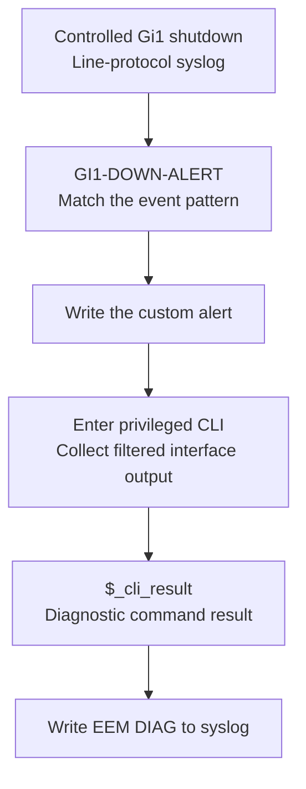
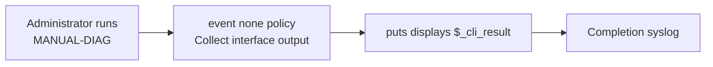
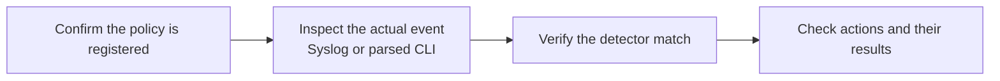

# EEM operation — from a trigger to useful diagnostics

EEM runs on EEM-R1. R2 supplies the directly connected test link; an external automation controller is not part of this lab.

## Automatic diagnostic flow

The selected CLI excerpt follows that sequence: line-protocol down, custom alert, then diagnostic output showing the interface administratively down. The diagnostic records the state at collection time; it is not a packet capture or an interface repair.

[Saved applet](configs/README.md#gi1-down-alert--capture-the-interface-state-after-a-matching-event) · [Observed diagnostic sequence](verification/syslog-triggered-diagnostics.md)

## Manual execution

**Reported observation:** manual execution displayed terminal output and a completion message. The automatic and fault tests instead retain selected CLI excerpts.

[Manual execution record](verification/manual-execution.md)

## CLI event handling

| Mode tested | Policy relationship to the original command |
|---|---|
| `sync no skip no` | Publish the event asynchronously and allow the command without waiting for policy completion |
| `sync yes` | Wait for the policy; `_exit_status 1` permits the command to run |

The synchronous test demonstrated permission to execute. It did not demonstrate a policy deliberately blocking a command. The temporary CLI-audit applet was removed after testing.

[CLI configurations](configs/exercise-applets.md#synchronous-cli-audit) · [Recorded validation](verification/cli-event-interception.md) · [Matching failure and repair](troubleshooting/cli-regex-matching.md)

## Locate the failing stage

Both cases failed at matching rather than requiring a change to the diagnostic actions. The syslog case identified a concrete message mismatch; the CLI case retained zero-match debug and a successful revised expression without inventing an explanation for the original mismatch.

[Case index](troubleshooting/README.md) · [Lessons learned](lessons-learned.md) · [Overview](README.md)
