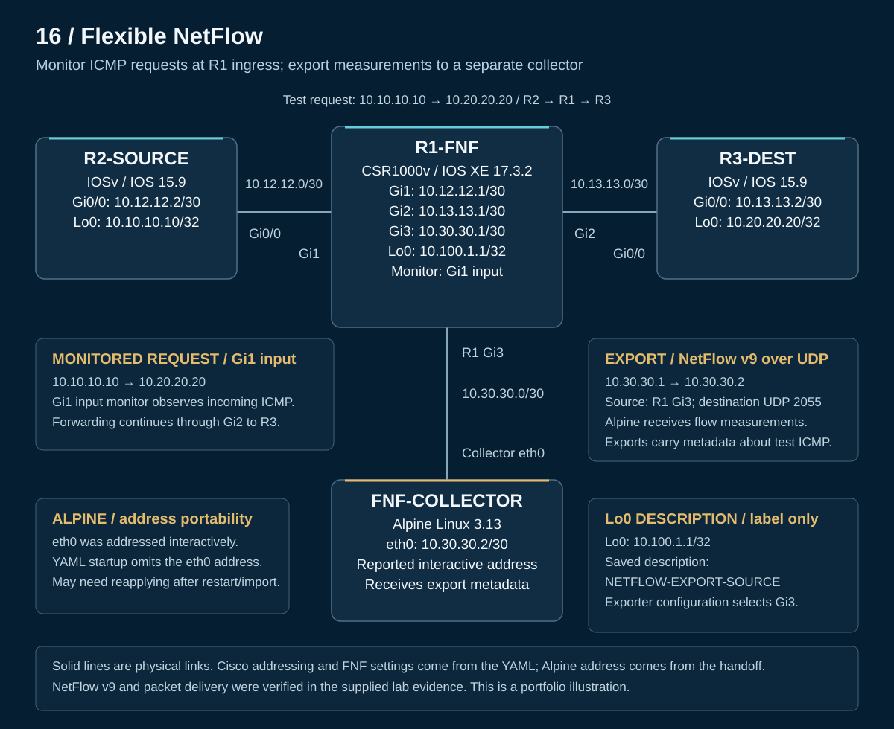

# 16 — Flexible NetFlow: Verify traffic from the router to the collector

I configured a router to measure traffic crossing a test network, export the measurements, and verify their arrival on a Linux collector. A controlled 100-packet test produced one monitored ICMP flow with **100 packets and 10,000 bytes**. The supplied collector decoding identified the same source, destination, protocol, and counters in a NetFlow v9 data record.

The engineering objective was to follow the evidence through three stages: successful forwarding, accurate local measurement, and remote export. This completed Cisco Modeling Labs exercise aligns with **CCNP ENCOR 350-401 v1.2, objective 4.2 — Configure and verify Flexible NetFlow**.

**Quick navigation:** [Results](#recorded-results) · [Topology](#lab-design) · [Process diagrams](operation.md) · [Configurations](configs/README.md) · [Verification](verification/README.md) · [Collector setup](configs/collector.md) · [Evidence scope](scope.md)

## Recorded results

| Verification question | Recorded outcome |
|---|---|
| Did the endpoint traffic cross the router? | Source-loopback to destination-loopback ping succeeded **100/100**, with round-trip min/avg/max **1/2/4 ms** |
| Did the input monitor measure the intended traffic? | One ICMP flow from `10.10.10.10` to `10.20.20.20`: **100 packets / 10,000 bytes** |
| Did an idle flow expire normally? | One flow aged through the **15-second inactive timeout**, leaving an empty cache |
| Did export traffic reach the collector? | Supplied UDP capture excerpts show `10.30.30.1` sending to `10.30.30.2:2055` |
| Could the exported record be interpreted? | Template **256** describes five fields; the supplied data decoding matches the monitored flow values |
| What did the final exporter report? | **25 export packets**, with **two client records / 50 bytes** sent; these are cumulative exporter statistics |

The [verification guide](verification/README.md) preserves the supplied commands and excerpts. Packet-capture decoding is documented from the handoff; a full hexadecimal capture or PCAP file was not supplied.

## Lab design

[PNG copy](topology.png) · [Addresses and wiring](topology.md) · [Sanitized CML export](CML-LAB.yaml)

R2-SOURCE generates ICMP traffic toward R3-DEST through R1-FNF. R1 monitors packets entering **Gi1**, then sends separate NetFlow export datagrams through **Gi3** to the Alpine collector. The collector receives traffic measurements; it is outside the endpoint forwarding path.

R1 uses CSR1000v / IOS XE 17.3.2; the endpoint routers use IOSv 15.9, and the collector uses Alpine Linux 3.13. Static routes provide endpoint reachability.

## Configuration approach

| Component | Role in this lab |
|---|---|
| Flow record | Source address, destination address, and protocol identify a flow; 64-bit counters accumulate bytes and packets |
| Flow monitor | Uses the record and exporter, with a configured 60-second active timeout; applied to Gi1 input |
| Flow exporter | Sends to `10.30.30.2` over UDP/2055, using Gi3's `10.30.30.1` address and a 60-second template refresh |

The observed inactive timeout was **15 seconds**, and operational output verified **NetFlow v9**. Neither value is explicitly configured in the saved export. The original exporter description, including its `ECNOR` typo, is preserved.

[Flow components and selected configuration](configs/flow-components.md) · [Router configuration files](configs/README.md)

## Engineering interpretation

The ping validates bidirectional reachability. The Gi1 input cache counts the source-to-destination requests: replies enter Gi2 and leave Gi1. The record therefore measures the selected direction rather than counting the entire exchange.

Flow-cache aging and template refresh answer different questions. Aging determines when a traffic record leaves the cache; a template tells the collector how to interpret exported fields. An empty cache after inactivity can be the expected result of successful monitoring.

This lab focused on working configuration and verification. Deliberate faults and troubleshooting exercises were deferred.

[Lessons learned](lessons-learned.md) · [Traffic and cache evidence](verification/traffic-and-cache.md) · [Export and template evidence](verification/export-and-templates.md)

## Portability

Alpine's tested `10.30.30.2/30` address was applied interactively and is absent from the YAML. Check the interface and reapply the address when needed using the [collector setup note](configs/collector.md). The sanitized export was checked for structure and configuration consistency; it was not reimported or rerun during portfolio preparation.

[Back to portfolio](../README.md)
