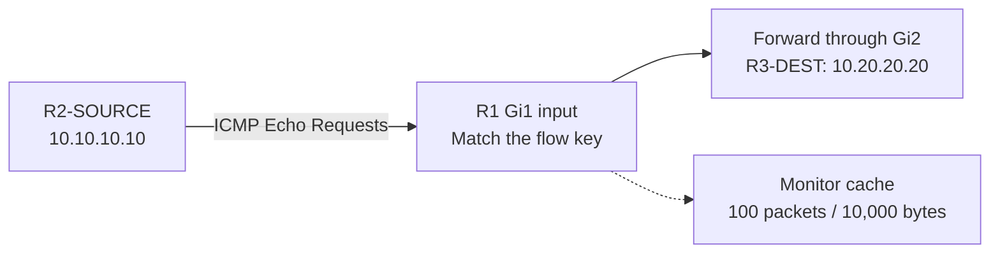
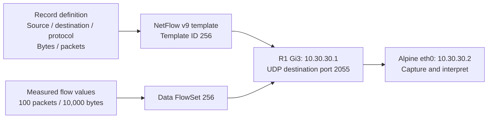

# Flexible NetFlow operation

## Forward packets and measure the selected direction

The solid path represents endpoint forwarding. The cache records measurements of requests entering Gi1. The successful **100/100** ping validates reachability in both directions; the cache counters measure only the configured input direction.

[Traffic and cache evidence](verification/traffic-and-cache.md)

## Send measurements to the collector

Export sends traffic metadata along the collector link. The template describes the five fields; the data record supplies their values. The handoff's decoded values match the local cache. The diagram explains those relationships and does not reproduce packet timing or imply that a template accompanies every data record.

[Template and data evidence](verification/export-and-templates.md) · [Collector setup](configs/collector.md)

## Keep three timers separate

| Timer | What it controls | Evidence in this lab |
|---|---|---|
| Inactive timeout: 15 seconds | Idle flow aging | One recorded inactive expiration |
| Active timeout: 60 seconds | Aging of an ongoing cached flow | Saved configuration and observed monitor setting |
| Template refresh: 60 seconds | Resending the record definition | Saved exporter setting and reported approximate recurrence |

Identical numerical settings do not give timers the same role. An empty cache after aging is expected; repeated template traffic describes the record structure rather than a new endpoint traffic burst.

[Flow configuration](configs/flow-components.md) · [Verification index](verification/README.md) · [Overview](README.md)
