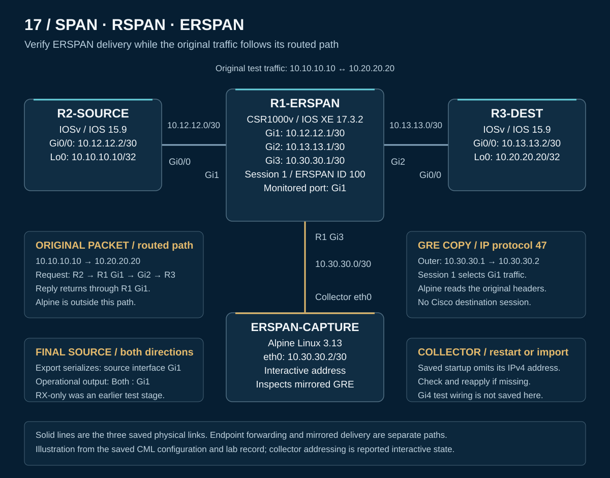

# 17 — SPAN/RSPAN/ERSPAN: Verify remote packet mirroring

I configured a transit router to send copies of selected traffic to a separate Linux collector while the original traffic continued to its destination. Collector-side inspection identified the original ICMP requests and replies inside ERSPAN packets, connecting the router's monitoring configuration to the traffic actually received.

This Cisco Modeling Labs exercise aligns with **CCNP ENCOR 350-401 v1.2, objective 4.3 — Configure SPAN/RSPAN/ERSPAN**. The completed hands-on result is **ERSPAN Type II**, as identified in the lab record's packet decoding. Local SPAN and RSPAN were investigated separately; neither produced a verified working mirroring implementation.

**Quick navigation:** [Results](#recorded-results) · [Topology](#lab-design) · [Process diagrams](operation.md) · [Configurations and reproduction](configs/README.md) · [Verification](verification/README.md) · [SPAN/RSPAN findings](investigations/README.md) · [Evidence scope](scope.md)

## Recorded results

| Verification question | Recorded outcome |
|---|---|
| Could R1 reach the collector? | **10/10** replies from `10.30.30.2` |
| Did the original endpoint traffic succeed? | R2-to-R3 loopback test: **100/100**; subsequent test: **10/10** |
| Did the RX-only session deliver mirrored packets? | **101 GRE packets**, with zero capture-kernel drops; the capture also contained non-ICMP traffic |
| Could the original traffic be identified? | Supplied decoding identifies ERSPAN ID **100**, inner `10.10.10.10 → 10.20.20.20`, and ICMP Echo Request |
| Did both directions reach the collector? | A **12-packet GRE capture** included Echo Request and Echo Reply, with a matching pair in sequences **122 / 123** |
| Did Local SPAN or RSPAN reach the same validation standard? | Local SPAN state was accepted but replication was not observed; RSPAN CLI was investigated without a forwarding test |

These are separate tests. The 101-packet RX capture is not 101 ICMP requests, and the 12-packet bidirectional capture is not a complete count of the ten-probe exchange. [Selected output and reported observations](verification/README.md) preserve those distinctions.

## Lab design

[PNG rendition](topology.png) · [Addresses and wiring](topology.md) · [Sanitized CML export](CML-LAB.yaml)

R2-SOURCE generates traffic toward R3-DEST through R1-ERSPAN. R1 monitors **Gi1** and sends the mirrored copies through **Gi3** to ERSPAN-CAPTURE. Alpine receives and inspects GRE directly; no Cisco ERSPAN destination session was built.

The saved topology contains four nodes and three links. The Local SPAN investigation used a separate test copy with a Gi4 destination; it is not part of this saved ERSPAN topology.

## Configuration approach

| Stage | Engineering purpose |
|---|---|
| Establish routed reachability | Static routes carry the original loopback traffic; R1 and Alpine share the collector subnet |
| Configure the source session | Session 1 selects Gi1, collector `10.30.30.2`, origin `10.30.30.1`, and ERSPAN ID 100 |
| Test RX monitoring | Observe incoming requests and inspect the encapsulated original packet |
| Restore both directions | Correlate the operational `Both : Gi1` state with captured requests and replies |

The export serializes the source as `source interface Gi1`, without an explicit `both` keyword. The selected operational output confirms **Both : Gi1**. The public configuration preserves the saved line rather than inserting a keyword to make it resemble the output.

## Engineering interpretation

The original packet uses the endpoint loopback addresses. The mirrored copy has a separate outer IPv4 header, using R1's `10.30.30.1` and the collector's `10.30.30.2`, with **GRE IP protocol 47**. This is an inspection path, not the endpoint forwarding path.

Packet decoding identified GRE protocol type `0x88BE`, ERSPAN ID 100, and the inner ICMP payload. The lab record identifies the format as Type II; the protocol type alone is not treated as an independent proof of that format. [Header interpretation](operation.md) explains the layers, and [evidence scope](scope.md) identifies the available source material.

The SPAN/RSPAN investigations demonstrate a second lesson: accepted syntax, an enabled session, and a monitoring interface are configuration evidence. Successful mirroring requires evidence at the receiving side.

[Lessons learned](lessons-learned.md) · [Capability investigations](investigations/README.md)

## Reuse the lab

Import the sanitized YAML using compatible local CML images, then follow the [reproduction guide](configs/README.md#reproduce-the-exercise). Alpine's `10.30.30.2/30` address was applied interactively and is absent from its saved startup script. [Collector setup](configs/collector.md) explains how to check and restore it after restart or import.

The public export has been checked for structure and configuration consistency; a fresh CML import or runtime test has not been performed during documentation preparation.

[Back to portfolio](../README.md)
