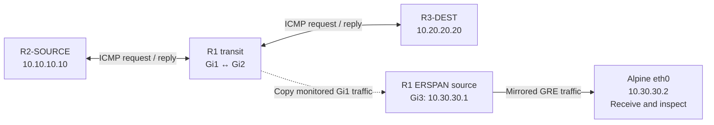
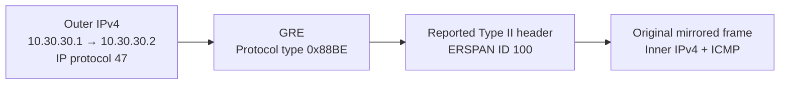

# ERSPAN operation — original traffic and mirrored copies

R1 forwards traffic between R2-SOURCE and R3-DEST, while its ERSPAN source session sends copies of monitored Gi1 traffic to Alpine. The lab record identifies the encapsulation as **ERSPAN Type II**; the diagrams explain that reported decode rather than reproduce a capture.

**Quick navigation:** [Traffic paths](#forward-the-original-traffic-and-send-a-copy) · [Packet interpretation](#read-the-inner-and-outer-headers) · [Direction and capture limits](#interpret-direction-and-capture-counts)

## Forward the original traffic and send a copy

The solid endpoint path represents the original exchange. Alpine receives the separate mirrored GRE traffic; it does not forward the original request to R3. It is a packet collector, not a configured Cisco ERSPAN destination session.

[Wiring and addresses](topology.md) · [Source-session settings](configs/README.md)

## Read the inner and outer headers

**Decoded observations from the lab record:**

| Layer or check | Recorded interpretation |
|---|---|
| Outer IPv4 | Source `10.30.30.1`, destination `10.30.30.2`; IP protocol **47 (GRE)** |
| GRE / ERSPAN | GRE protocol type `0x88BE`; reported Type II decoding with ERSPAN ID **100** (`0x0064`) |
| Original Echo Request | Inner `10.10.10.10 → 10.20.20.20`; ICMP type **8**, code **0** |
| Original Echo Reply | Inner `10.20.20.20 → 10.10.10.10`; ICMP type **0** |
| Representative size | Outer IPv4 total length **150 bytes** for the encapsulated **100-byte** IPv4 ICMP packet |

The outer addresses identify the mirror-delivery path; the inner addresses identify the original endpoints. The reported Type II identification follows the lab record's decoding, rather than classification from `0x88BE` alone. No missing header bytes are reconstructed here.

## Interpret direction and capture counts

RX-only monitoring of Gi1 captured incoming traffic. The later session output reported **Both : Gi1**, and payload inspection identified requests and replies, including a matching pair in GRE sequences **122** and **123**.

The RX-only capture reported **101 GRE packets**, including a separate packet; the record does not identify all 101 as ICMP. Payload inspection also found a mirrored CDP advertisement. The later **12-packet** GRE capture demonstrates both directions, without establishing a complete capture of every request and reply in the **10/10** ping test. Reported zero capture-kernel drops are a collector observation, not a completeness guarantee.

[Verification](verification/README.md) · [Lessons learned](lessons-learned.md) · [Evidence scope](scope.md) · [Overview](README.md)
