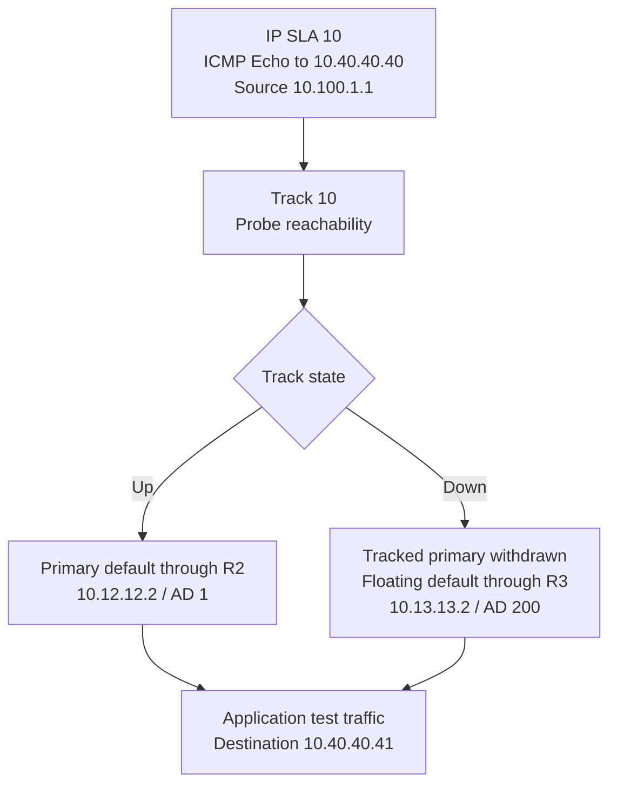
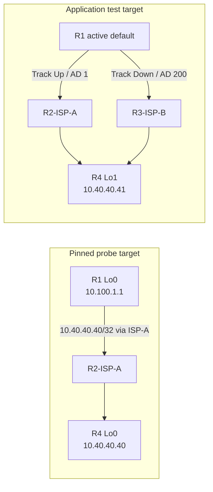

# IP SLA operation — probe, track, and route selection

R1 uses an ICMP Echo probe to monitor a target beyond ISP-A. Track 10 consumes that reachability result and controls the primary default. A floating default through ISP-B provides the alternate path for a separate application test address.

**Quick navigation:** [Route decision](#turn-probe-reachability-into-a-route-decision) · [Separate target paths](#keep-the-probe-and-application-test-distinct) · [Failure and recovery](#interpret-the-controlled-failure-and-recovery)

## Turn probe reachability into a route decision

This diagram explains the configured dependency. The supplied output records probe success, Up/Down tracking transitions, and both default-route states. It does not measure an exact failover interval or continuous application availability.

| Saved setting | Interpretation |
|---|---|
| Frequency 10 seconds | Probe interval configured for this lab |
| Timeout 2000 ms | Configured response wait for an operation |
| Threshold 1000 ms | Final threshold kept below timeout after the observed scheduling rejection |
| No configured tracking delay | Additional Up/Down delay controls were not implemented in this exercise |

Track 10 follows operation reachability. The 1000-ms threshold was not a standalone latency trigger for withdrawing the default; the controlled fault tested lost reachability beyond R2.

## Keep the probe and application test distinct

The probe-target host route keeps `.40` through R2 while the primary next hop remains resolvable. During the controlled upstream outage, R1 Gi1 remains `up/up`, so backup forwarding to `.41` does not redirect the probe through ISP-B and falsely signal primary recovery.

The `.41` address is a separate ICMP/traceroute target representing application reachability. It has no R1 host route of its own and follows the selected default. No separate application service or workload was tested.

R4 also needs a return path to the branch source. Its saved `/32` routes configure `10.24.24.1` through R2 as primary, with an AD 200 alternative through `10.34.34.1` through R3. These routes depend on next-hop resolution and are not controlled by R1's Track 10. No supplied R4 route output establishes its runtime return-route selection.

## Interpret the controlled failure and recovery

The temporary fault shuts **R2 Gi0/1**, the link to **R4 Gi0/1**. The branch-facing R1 Gi1 link stays in service. This tests reachability beyond the directly connected interface, rather than substituting a branch link-down event for the upstream failure.

After the failed probe changes Track 10 to Down, the primary default is withdrawn and the floating default supplies the application test path through R3. The supplied excerpts show a later successful application ping and a traceroute through ISP-B. They do not quantify packet loss during route transition.

Restoring the same R2 interface allows the pinned probe to succeed again. The supplied excerpts show Track 10 returning Up, the primary default through R2, and the application traceroute using ISP-A. Probe frequency, timeout, and routing state affect the timing; no instantaneous or zero-loss behavior is promised.

These illustrations follow the supplied configuration and historical lab excerpts. Fresh import and execution of the sanitized export remain pending. [Controlled test steps](configs/README.md#exercise-the-upstream-outage-and-restore-it) describe reproduction without presenting new results.

[Overview](README.md) · [Topology](topology.md) · [Configurations](configs/README.md) · [Verification](verification/README.md) · [Evidence scope](scope.md)
