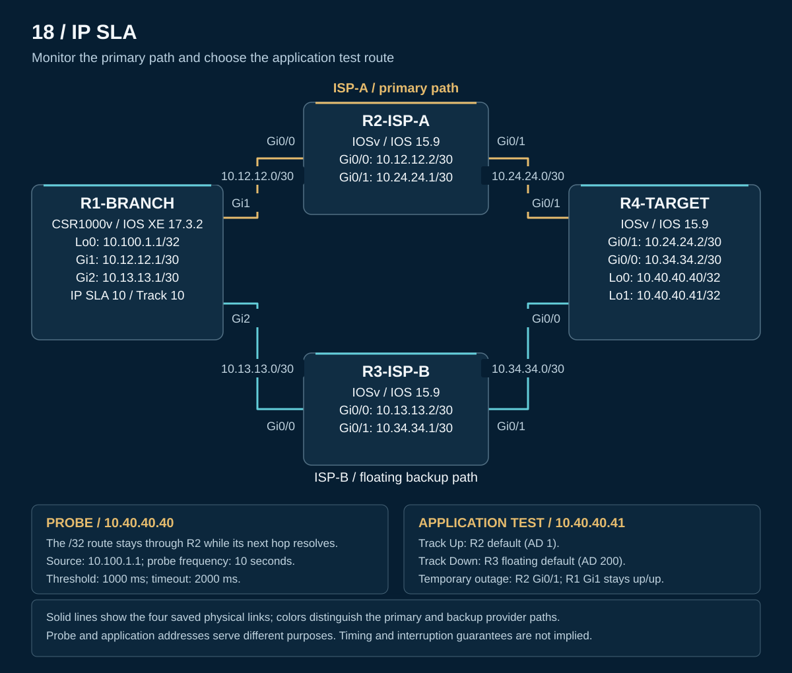

# IP SLA topology and addressing

[PNG rendition](topology.png) · [Public CML export](CML-LAB.yaml)

The supplied topology contains four routers and four physical links. Addresses and wiring below follow the saved YAML. The diagram illustrates the configured design; it is not a captured runtime display.

| Device | Platform | Role |
|---|---|---|
| R1-BRANCH | CSR1000v / IOS XE 17.3.2 | Probe source, Track 10, primary and floating defaults |
| R2-ISP-A | IOSv / IOS 15.9(3)M3 | Primary provider path |
| R3-ISP-B | IOSv / IOS 15.9(3)M3 | Backup provider path |
| R4-TARGET | IOSv / IOS 15.9(3)M3 | Separate probe and application test loopbacks |

## Addressing

| Device / interface | Address | Purpose |
|---|---|---|
| R1 Loopback0 | `10.100.1.1/32` | Source for the probe and application tests |
| R1 Gi1 | `10.12.12.1/30` | Primary link to R2 |
| R1 Gi2 | `10.13.13.1/30` | Backup link to R3 |
| R2 Gi0/0 | `10.12.12.2/30` | R1 primary next hop |
| R2 Gi0/1 | `10.24.24.1/30` | Primary link to R4; temporary shutdown target |
| R3 Gi0/0 | `10.13.13.2/30` | R1 backup next hop |
| R3 Gi0/1 | `10.34.34.1/30` | Backup link to R4 |
| R4 Gi0/1 | `10.24.24.2/30` | Receives the ISP-A link |
| R4 Gi0/0 | `10.34.34.2/30` | Receives the ISP-B link |
| R4 Loopback0 | `10.40.40.40/32` | IP SLA probe target |
| R4 Loopback1 | `10.40.40.41/32` | Application test target |

## Physical wiring

| Link ID | First endpoint | Second endpoint | Subnet |
|---|---|---|---|
| l0 | R1 GigabitEthernet1 | R2 GigabitEthernet0/0 | `10.12.12.0/30` |
| l1 | R1 GigabitEthernet2 | R3 GigabitEthernet0/0 | `10.13.13.0/30` |
| l3 | R2 GigabitEthernet0/1 | R4 GigabitEthernet0/1 | `10.24.24.0/30` |
| l2 | R3 GigabitEthernet0/1 | R4 GigabitEthernet0/0 | `10.34.34.0/30` |

The R4 interface mapping is deliberate: **Gi0/1 faces ISP-A; Gi0/0 faces ISP-B**. The original lab corrected this mapping during neighbor-based troubleshooting. Other defined physical ports are unconnected in the saved topology. R4 Loopback1 is created by its saved router configuration and carries no physical link.

## Probe and application paths

The `.40` probe uses **R1 → R2 → R4** because R1 has a primary-path `/32` route to `10.40.40.40`. That pinning depends on the primary next hop remaining resolvable. The controlled R2-to-R4 outage leaves R1's directly connected primary link operational.

Traffic to `.41` follows R1's active default: **R1 → R2 → R4** while Track 10 is Up, then **R1 → R3 → R4** after the tracked primary default is withdrawn. The lab used ICMP and traceroute to this application test address; it did not exercise a separate application service.

R4 is configured with a return route to `10.100.1.1/32` through R2 and an AD 200 alternative through R3. This return-route design is preserved alongside R1's tracked defaults; no supplied R4 route output establishes its runtime selection.

[Overview](README.md) · [Configuration and controlled test](configs/README.md) · [Operation](operation.md) · [Verification](verification/README.md) · [Evidence scope](scope.md)
