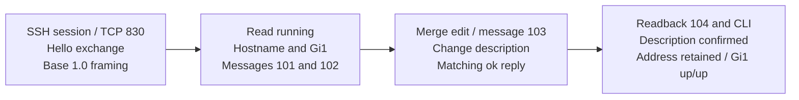
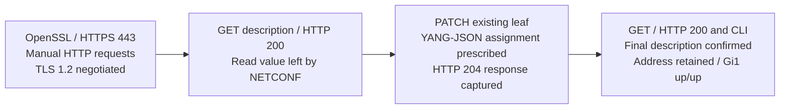

# NETCONF and RESTCONF operation — request, change, and verify

The client used two protocols to manage the same configuration on R1. The diagrams connect the recorded requests to their readbacks and independent CLI checks; they explain the lab sequence rather than representing new packet captures.

**Quick navigation:** [NETCONF sequence](#netconf-read-edit-and-readback) · [RESTCONF sequence](#restconf-get-patch-and-get) · [Shared model](#identify-the-same-configuration-through-two-protocols)

## NETCONF read, edit, and readback

The running datastore was the explicit source and target. The edit selected GigabitEthernet entry `1` and supplied its description, using `default-operation` merge. The readback retained `192.0.2.10` and mask `255.255.255.0` alongside the changed description.

The server advertised base 1.1 as well as base 1.0; the client advertised base 1.0 and used `]]>]]>` delimiters. A NETCONF 1.1 chunked session was not demonstrated. Candidate was explicitly disabled in the service-status output, so this was not a candidate/commit workflow.

The request for message 104 is prescribed lab content; its reply is captured. That distinction remains visible in [NETCONF Block 08](verification/netconf.md#block-08).

## RESTCONF GET, PATCH, and GET

RESTCONF first read the value left by NETCONF, then changed the existing description leaf. The captured HTTP response sequence is **200 → 204 → 200**. The PATCH body's assignment is prescribed; the captured command references its variable, and the later GET and CLI establish the resulting value. No expanded on-wire request body or numeric transmitted Content-Length is supplied.

OpenSSL negotiated TLS 1.2 and reported a self-signed certificate verification error. This record proves the negotiated transport and application responses, without establishing certificate trust. The displayed router settings also enabled plain HTTP; these requests used port 443.

[RESTCONF evidence](verification/restconf.md) · [Transport and service checks](verification/connectivity-and-services.md)

## Identify the same configuration through two protocols

| Configuration element | NETCONF representation | RESTCONF representation |
|---|---|---|
| Native model | XML native namespace identifies Cisco-IOS-XE-native | Resource path begins with `Cisco-IOS-XE-native:native` |
| Interface instance | `GigabitEthernet` list with `<name>1</name>` | Keyed path segment `GigabitEthernet=1` |
| Description | `<description>` element in the edit configuration | Description leaf resource with a module-qualified JSON value |
| Result validation | Matching RPC reply, protocol readback, and CLI | HTTP status, GET readback, and CLI |

The native model provides the structure addressed by each request. The exercise changed an interface description, not its IP address or forwarding policy. The two CLI snapshots independently retain that address and up/up state; neither establishes persistence across a router reboot.

[Overview](README.md) · [Topology](topology.md) · [NETCONF procedure](configs/netconf.md) · [RESTCONF procedure](configs/restconf.md) · [Verification matrix](verification/README.md) · [Evidence scope](scope.md)
