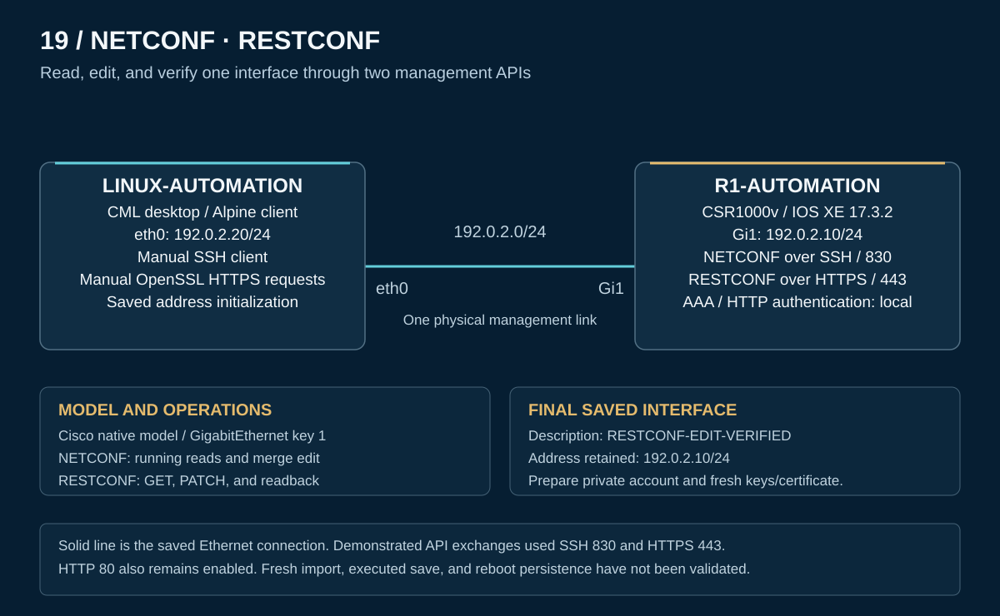

# NETCONF and RESTCONF topology

[PNG rendition](topology.png) · [Sanitized CML export](CML-LAB.yaml)

The saved lab contains two nodes and one direct Ethernet link. Node definitions, image definitions, interface IDs, and link associations are preserved from the private export. The diagram illustrates that saved design and the protocols used in the supplied exchanges.

| Node | Definition / image | Role |
|---|---|---|
| n0 — LINUX-AUTOMATION | `desktop` / `desktop-3-13-2-xfce` | Client terminal using SSH and OpenSSL |
| n1 — R1-AUTOMATION | `csr1000v` / `csr1000v-170302` | IOS XE 17.3.2 NETCONF and RESTCONF server |

## Addressing

| Endpoint | Address | Source and role |
|---|---|---|
| Client eth0 | `192.0.2.20/24` | Saved startup address initialization; captured client address and connected route |
| Router GigabitEthernet1 | `192.0.2.10/24` | Saved management address; captured API readback and post-edit CLI |

The client startup script contains its address initialization. No fresh-import or reboot execution of that script was validated during portfolio preparation.

## Physical wiring

| Link | First endpoint | Second endpoint | Subnet |
|---|---|---|---|
| l0 | n1 / i1 — R1 GigabitEthernet1 | n0 / i0 — client eth0 | `192.0.2.0/24` |

Gi2–Gi4 are defined, unconnected, unaddressed, and shutdown in the saved router configuration. No intermediate switch, gateway, or additional routing path is part of this lab.

## Protocol and configuration roles

NETCONF uses SSH port **830** and the `netconf` subsystem. RESTCONF uses HTTPS port **443**, carrying manually constructed HTTP/1.1 through OpenSSL. Plain HTTP port **80** also remains enabled in the saved router settings; the demonstrated RESTCONF exchanges used TLS.

Both protocols target the Cisco native model's GigabitEthernet list entry keyed by `1`. The changed leaf is its description. The saved final value is **RESTCONF-EDIT-VERIFIED**, and the management address is retained. [Protocol procedures](configs/README.md) explain the different request forms; [verification](verification/README.md) separates captured results from prescribed request content.

The public export omits the original account and generated PKI material. Prepare a private replacement privilege 15 account before import/start, then establish fresh keys and certificate material through the console as needed. Sanitization and static checks do not establish a fresh working API session, executed save, or reboot persistence.

[Overview](README.md) · [Configurations](configs/README.md) · [Operation](operation.md) · [Verification](verification/README.md) · [Evidence scope](scope.md)
