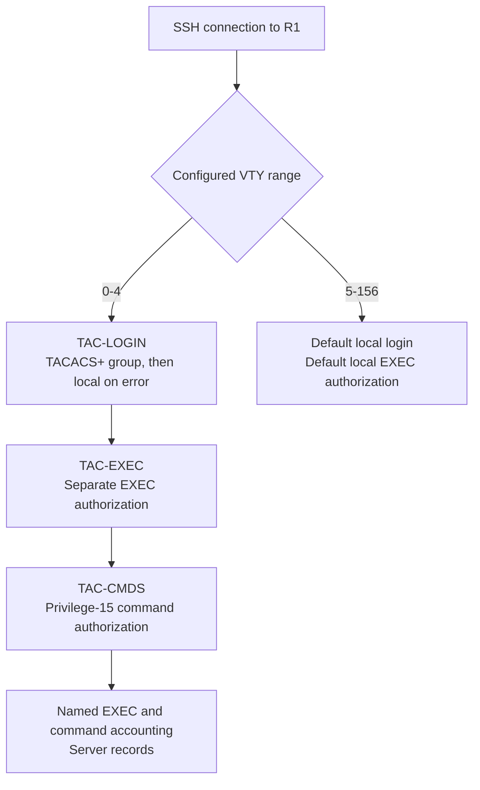
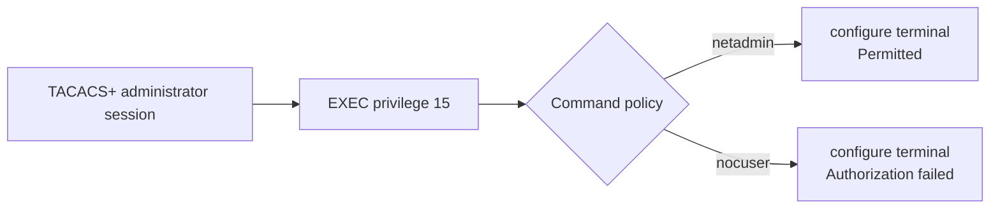

# AAA operation — authenticate, authorize, account, and recover

These diagrams explain the configured policy and connect it to the supplied verification. They are design illustrations, not packet captures or newly executed tests.

**Quick navigation:** [VTY policy](#follow-the-configured-vty-policy) · [Role decisions](#separate-privilege-from-command-permission) · [Recovery](#interpret-the-outage-and-recovery) · [Accounting and persistence](#connect-accounting-and-persistence-to-evidence)

## Follow the configured VTY policy

The server group is `ADMIN-SERVERS`; its TAC1 target is `192.0.2.20`. R1's configured TACACS+ source interface is Gi1, using `192.0.2.10`. The named lists apply to VTY 0–4; higher VTY lines use the default local login and EXEC policies.

A configured local alternative is tried after the preceding authentication method returns an error, such as server unavailability; an explicit authentication denial ends that attempt. The outage and rejection excerpts do not capture the server's exact result or the SSH session's VTY slot. The diagram describes policy, not proof that every test followed its centralized branch.

## Separate privilege from command permission

The supplied output shows both accounts at privilege 15. The NOC group explicitly denies the `configure` command while its default service policy permits other requests. This is a granular lab restriction, not a complete read-only allowlist. [Role verification](verification/authorization.md)

## Interpret the outage and recovery

The retained sequence is: recovery-account SSH rejection while the server is online; deliberate daemon shutdown with no process/listener remaining; successful local SSH at privilege 15 during the outage; and successful centralized authentication after restoration.

This supports local administrative access while the server is unavailable and agrees with the fallback design. Because VTY 5–156 also uses local defaults and the session slot was not captured, the successful session alone cannot establish which configured method-list path supplied access. The online rejection is also consistent with TACACS+ FAIL without proving a captured FAIL transaction. [Outage evidence and limits](verification/failure-recovery.md)

No privilege-15 command-authorization fallback test or accounting continuity during the outage is added to these observations.

## Connect accounting and persistence to evidence

The accounting file retains an EXEC start, two command records, and an EXEC stop. Its selected command records identify `show running-config` and `configure terminal`; a `stop` record is not an authorization-denial message. The displayed five-second elapsed value belongs to that session, not to a failover measurement. [Server-side accounting](verification/accounting.md)

Netplan supplies the observed internal guest address; systemd starts the foreground `tac_plus` process bound to `192.0.2.20`. After an actual Ubuntu reboot, the captured address, route, service, listener, ping, and authentication checks support server persistence. R1's startup configuration was inspected separately; the router itself was not reboot-tested. [Ubuntu persistence](verification/persistence.md) · [Router startup inspection](verification/startup.md)

[Overview](README.md) · [Configurations](configs/README.md) · [Topology](topology.md) · [Verification matrix](verification/README.md) · [Evidence scope](scope.md)
