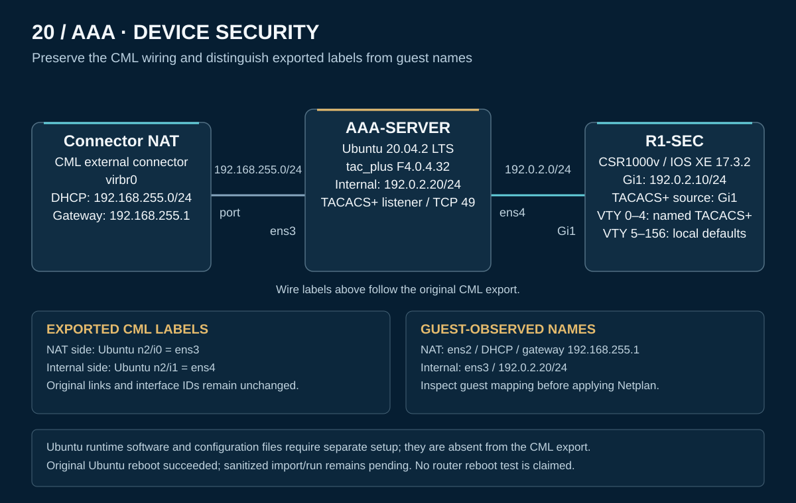

# AAA topology and interface provenance

[PNG rendition](topology.png) · [Sanitized CML export](CML-LAB.yaml) · [Original CML workbench capture](verification/cml-workbench-capture.png)

The original export contains three nodes and two links. The supplied workbench screenshot shows the exported Ubuntu labels `ens3` toward NAT and `ens4` toward R1. Guest observations name those same connection roles `ens2` and `ens3`. The public export preserves its original references and does not silently rename or rewire them.

| Node | Definition / image | Role |
|---|---|---|
| n0 — Connector NAT | `external_connector`; configuration `virbr0` | NAT access for Ubuntu |
| n2 — AAA-SERVER | `ubuntu` / `ubuntu-20-04-20210224` | Ubuntu 20.04.2 LTS, Shrubbery `tac_plus` F4.0.4.32 |
| n1 — R1-SEC | `csr1000v` / `csr1000v-170302` | IOS XE 17.3.2 SSH and TACACS+ client |

## Physical wiring

| Link | First endpoint | Second endpoint | Role |
|---|---|---|---|
| l0 | n0/i0 — Connector NAT `port` | n2/i0 — Ubuntu export label `ens3` | NAT / DHCP connection |
| l1 | n2/i1 — Ubuntu export label `ens4` | n1/i1 — R1 GigabitEthernet1 | Internal `192.0.2.0/24` link |

## Export labels and guest observations

| Role | Exported Ubuntu label | Guest-observed name and address |
|---|---|---|
| NAT | `ens3` (i0) | `ens2`; DHCP on `192.168.255.0/24`, default gateway `192.168.255.1` |
| Internal AAA | `ens4` (i1) | `ens3`; `192.0.2.20/24`, listener `192.0.2.20:49` |
| Router endpoint | R1 GigabitEthernet1 (i1) | `192.0.2.10/24`; TACACS+ source interface |

The supplied [Netplan file](configs/ubuntu-netplan.yaml) uses the guest-observed internal `ens3`. Inspect actual guest interfaces in a new import before applying it. The static Ubuntu address, daemon installation, policy, and systemd unit are not part of the CML YAML's saved runtime state.

## Control and validation paths

R1 sends TACACS+ traffic from Gi1 to the Ubuntu listener on TCP 49. Named authentication, EXEC/privilege-15 command authorization, and accounting lists apply to **VTY 0–4**. **VTY 5–156** retain the local default policies and SSH transport.

The NAT connection provides Ubuntu's external access; it is separate from the directly connected R1/server AAA subnet. The diagram does not imply centralized AAA coverage for every VTY or a comprehensive read-only NOC policy.

The original Ubuntu reboot results and router startup inspection are documented in [verification](verification/README.md). The sanitized export and separately reconstructed TACACS+ template have not been freshly imported or executed. No router reboot test is claimed.

[Overview](README.md) · [Configurations](configs/README.md) · [Ubuntu setup](configs/ubuntu-setup.md) · [Operation](operation.md) · [Verification](verification/README.md) · [Evidence scope](scope.md)
