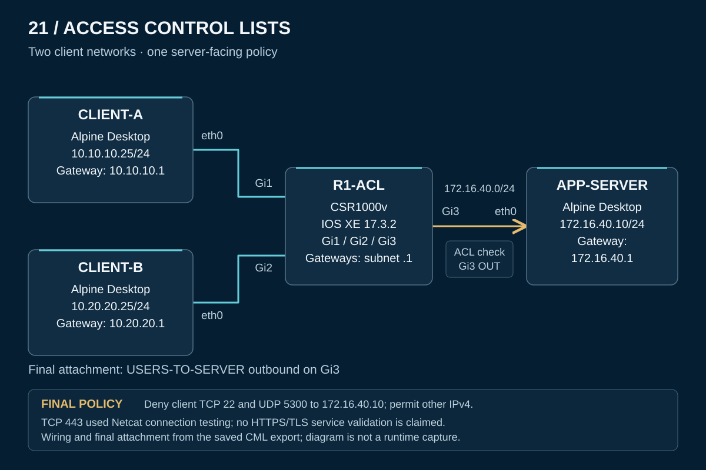

# 21 — Access Control Lists: Control access and verify the policy

I configured an extended IPv4 access list to block SSH and selected UDP traffic from two client networks to an application server while allowing other traffic. I then tested how rule order, interface direction, and TCP port matching could change the result—and restored the intended policy after each experiment.

This Cisco Modeling Labs exercise covers **CCNP ENCOR 350-401 v1.2, 5.2.a — Access control lists (ACLs)** at the configure-and-verify level. The goal was to connect each filtering decision to the packet's fields, its path through the router, and an independent test.

**Quick navigation:** [Results](#lab-results) · [Topology](#lab-design) · [Packet flow](operation.md) · [Configurations](configs/README.md) · [Verification matrix](verification/README.md) · [Troubleshooting cases](troubleshooting/README.md) · [Evidence scope](scope.md)

## Lab results

| Engineering question | Reported outcome |
|---|---|
| Was connectivity working before filtering? | Nine repeated ICMP tests had zero packet loss; both clients established SSH sessions and TCP 443 connections to APP-SERVER |
| Did the final policy restrict the intended services? | Both clients' SSH attempts were denied; UDP destination port 5300 denies registered matches; ICMP and TCP 5300 tests succeeded |
| Could an earlier permit bypass a later deny? | A temporary sequence-5 permit allowed CLIENT-A SSH while CLIENT-B remained denied; removing it restored CLIENT-A's restriction |
| Did interface direction matter? | With the policy on Gi3 inbound, both clients could connect to TCP 22; restoring Gi3 outbound reinstated the restrictions |
| Did port matching affect return traffic? | Incorrect source/destination port conditions blocked connections; correcting the conditions restored them |
| Was the configuration retained? | The lab report records saving the configuration and checking the ACL and Gi3 outbound attachment in startup-config; no router reload result was supplied |

The supplied **CML export provides the saved configuration**. Test outcomes and final counter totals come from the accompanying **lab result summary**, without a raw terminal transcript or screenshots. The [verification matrix](verification/README.md) identifies these evidence boundaries. TCP 443 was tested with **Netcat**, so its success establishes TCP connectivity, not HTTPS or TLS operation.

## Lab design

[Addresses and wiring](topology.md) · [PNG copy](topology.png) · [Sanitized CML export](CML-LAB.yaml)

R1-ACL runs **CSR1000v / IOS XE 17.3.2**. Three Alpine Desktop nodes provide two traffic sources and one destination. Client traffic enters Gi1 or Gi2, is routed toward APP-SERVER, and meets `USERS-TO-SERVER` as it leaves **Gi3**.

| Device | Address | Router connection |
|---|---|---|
| CLIENT-A | `10.10.10.25/24` | Gi1 — `10.10.10.1/24` |
| CLIENT-B | `10.20.20.25/24` | Gi2 — `10.20.20.1/24` |
| APP-SERVER | `172.16.40.10/24` | Gi3 — `172.16.40.1/24` |

## Implementation approach

1. Establish baseline connectivity and endpoint service availability before adding a filter.
2. Apply the named extended ACL outbound on the shared server interface.
3. Compare client results with ACL matches, then isolate rule-order and direction errors.
4. Separate TCP from UDP testing on port 5300 and examine how ports change direction in replies.
5. Remove experimental policies, repeat the final checks, and save the intended configuration.

The final ACL denies TCP destination port **22** and UDP destination port **5300** from each client network to `172.16.40.10`. Its last entry is **`permit ip any any`**, so it allows other IPv4 traffic at this attachment. This is a targeted filtering exercise, not a restrictive application allowlist or a stateful firewall. [Saved configuration and ACE interpretation](configs/README.md)

## Troubleshooting cases

| Case | What the investigation demonstrates |
|---|---|
| [ACE shadowing](troubleshooting/01-ace-shadowing.md) | A matching earlier permit can prevent a later deny from being evaluated |
| [Incorrect interface direction](troubleshooting/02-interface-direction.md) | A correct rule cannot filter a packet that does not cross its attachment in the configured direction |
| [TCP ports and return traffic](troubleshooting/03-ports-and-return-path.md) | Match the actual packet fields in each direction; TCP `established` checks flags rather than tracking sessions |

Each case separates the reported symptom, investigation, correction, and recovery from the explanatory illustrations. Temporary ACE text and packet captures were not supplied; they are not recreated as recorded evidence.

## Final state and lessons

Only `USERS-TO-SERVER` remains as the experimental lab's final IPv4 ACL, attached **outbound on Gi3**. The final report records both SSH restrictions, both ICMP permits, and both TCP 5300 permits. Reported counter totals are retained separately from the YAML and are not treated as per-test packet counts. [Final validation](verification/final-state.md) · [Counters](verification/filtering-and-counters.md)

The main engineering lesson is to verify **the rule, its position, its attachment, and the traffic itself**. A successful ping does not establish service access; a failed connection alone does not identify an ACL as its cause. The baseline and counter checks help make that distinction. [Lessons learned](lessons-learned.md)

The sanitized export preserves the four-node, three-link topology and saved addressing/filtering configuration. A fresh CML import, endpoint service setup, and execution of that sanitized copy remain untested. [Configuration provenance](configs/README.md) · [Scope and remaining evidence](scope.md)

[Back to portfolio](../README.md)
