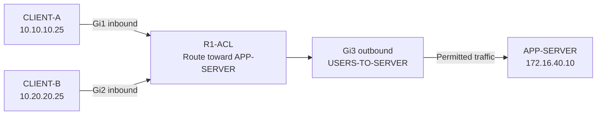
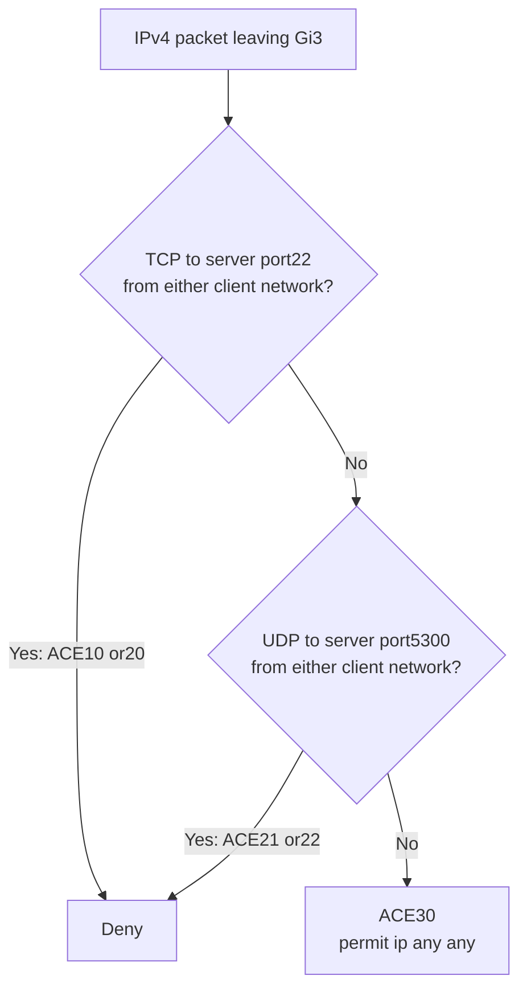
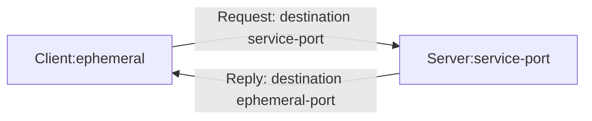

# ACL operation — follow the packet before changing the policy

These diagrams explain the saved configuration and reported experiments. They are design illustrations, not packet captures or additional test results.

**Quick navigation:** [Forward path](#follow-client-traffic-to-the-server) · [Rule decisions](#read-the-acl-in-order) · [Return path](#separate-forward-and-return-port-fields) · [Evidence](verification/README.md)

## Follow client traffic to the server

Both client networks share the server-facing egress, so Gi3 outbound gives this lab one filtering point. Gi3 inbound sees packets arriving **from the server network**. Moving the client-to-server ACL there no longer examines those requests on their way out to the server. [Direction experiment](troubleshooting/02-interface-direction.md)

The final configuration has no experimental return-path ACL. A reply enters Gi3 and leaves Gi1 or Gi2; it does not traverse Gi3 outbound. This direction explanation describes the topology, not a capture of a particular reply.

## Read the ACL in order

The saved ACL evaluates ACEs **10, 20, 21, 22, then 30**. Each packet receives the action of its first matching entry. The diagram groups the two client-network entries for readability; it does not change the saved order.

A temporary earlier permit matched CLIENT-A's SSH traffic before its deny. CLIENT-B remained denied in the reported experiment. The exact sequence-5 ACE was not retained, so the [shadowing case](troubleshooting/01-ace-shadowing.md) explains the observed difference without inventing its text.

## Separate forward and return port fields

The following is a **schematic TCP exchange**, not a recorded five-tuple. `ephemeral` means the client-selected source port; no numeric value was supplied.

The service port is the destination in a normal client request and the source in its reply. A condition placed after the source address tests the source port; after the destination address, it tests the destination port. TCP and UDP also remain different protocols even when they use the same number, such as **5300**.

The temporary inbound return-path experiment used TCP `established`. That keyword matches packets with **ACK or RST** set; it does not maintain a connection table or validate a complete session. The experiment's reported recovery is retained, but its exact ACEs and handshake packets were not supplied. [Ports and return-path case](troubleshooting/03-ports-and-return-path.md)

[Overview](README.md) · [Topology](topology.md) · [Configurations](configs/README.md) · [Verification matrix](verification/README.md) · [Evidence scope](scope.md)
