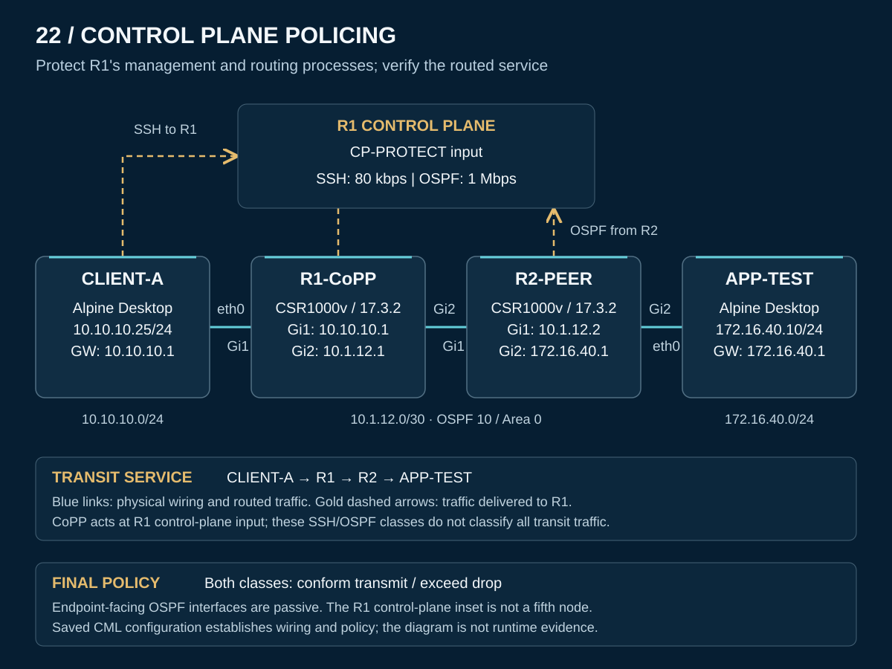

# 22 — Control Plane Policing: Preserve router access and routing

I configured separate traffic policers for SSH access to R1 and OSPF messages from its routing peer. Two controlled faults showed how a protection policy can also interrupt essential services: an undersized SSH policer disrupted access, while an incorrect OSPF action dropped traffic even within the configured rate. Restoring the intended settings recovered administrative access, routing, and connectivity to the remote network.

This Cisco Modeling Labs exercise covers **CCNP ENCOR 350-401 v1.2, 5.2.b — Control plane policing** at the configure-and-verify level. The aim was to connect classification, policing actions, and service outcomes rather than judge the policy by its configuration alone.

**Quick navigation:** [Results](#lab-results) · [Topology](#lab-design) · [How CoPP works](operation.md) · [Configurations](configs/README.md) · [Verification matrix](verification/README.md) · [Troubleshooting](troubleshooting/README.md) · [Evidence scope](scope.md)

## Lab results

| Engineering question | Reported outcome |
|---|---|
| Did SSH work with the original policy? | Authentication succeeded at 80 kbps; 46 packets conformed and none exceeded |
| What happened at 8 kbps? | With a 1,500-byte burst allowance, the exceeded total rose to 7 and then 10; a subsequent SSH attempt was closed |
| Did restoring 80 kbps recover access? | SSH authenticated at privilege 15; the recovery comparison added 66 conforming packets with no increase in exceeded packets |
| Could OSPF fail without exceeding its CIR? | Changing the conform action to drop at the unchanged 1-Mbps CIR led to dead-timer expiration, adjacency loss, and removal of the remote route |
| Did the correction restore routing? | Restoring conform transmit returned the neighbor to FULL and reinstalled `172.16.40.0/24` through `10.1.12.2` |
| Did traffic reach the remote endpoint afterward? | CLIENT-A to APP-TEST received **10/10 ICMP replies**, with zero packet loss |
| Was the final configuration retained? | Both router startup configurations were inspected; no router reload verification was performed |

The **original CML export establishes the saved configuration**. Historical counters, console events, and test outcomes above are **reported results from the lab handoff**; their raw terminal transcripts were not supplied. The [verification guide](verification/README.md) keeps those sources separate.

## Lab design

[Addresses and wiring](topology.md) · [PNG copy](topology.png) · [Sanitized CML export](CML-LAB.yaml)

Two **CSR1000v / IOS XE 17.3.2** routers join two Alpine Desktop networks. OSPF process **10**, Area **0**, runs on the inter-router link; both edge LANs are advertised through passive interfaces.

| Segment | Endpoint | Router interface |
|---|---|---|
| Client LAN | CLIENT-A — `10.10.10.25/24` | R1 Gi1 — `10.10.10.1/24` |
| Router link | R1 — `10.1.12.1/30`; R2 — `10.1.12.2/30` | R1 Gi2 ↔ R2 Gi1 |
| Remote LAN | APP-TEST — `172.16.40.10/24` | R2 Gi2 — `172.16.40.1/24` |

## Final policy

| Class | Classification | CIR | Conform / exceed actions |
|---|---|---:|---|
| `CP-SSH` | `COPP-SSH`: TCP destination 22 to R1 address `10.10.10.1`, from any source | 80,000 bps | Transmit / drop |
| `CP-OSPF` | `COPP-OSPF`: OSPF from peer `10.1.12.2` | 1,000,000 bps | Transmit / drop |

`CP-PROTECT` is attached with **`service-policy input` under `control-plane`** on R1. The ACLs identify traffic for the classes; the policy determines its treatment. This SSH class covers the specified destination address, not every address on the router. No explicit final burst value is present in the saved policy. [Configuration details](configs/README.md)

## Troubleshooting cases

| Case | Engineering lesson |
|---|---|
| [SSH policer exhaustion](troubleshooting/01-ssh-policer-exhaustion.md) | Compare conform/exceed changes with actual login results, then verify recovery after restoring the rate |
| [Incorrect OSPF conform action](troubleshooting/02-ospf-conform-action.md) | A suitable CIR cannot compensate for an action that drops conforming routing traffic |

The final ICMP test exercised traffic through the routers. It validates restored reachability after routing recovery; it is not evidence that ICMP matched either CoPP class or that router CPU capacity was measured. [Operating explanation](operation.md) · [Lessons learned](lessons-learned.md)

## Saved state and reuse

The public export removes the local password hash, generated cryptographic material, device identifiers, and unrelated generated metadata while retaining the topology, addressing, OSPF, and final CoPP policy. A private local account and SSH keys must be prepared through the console before SSH reuse; the [configuration guide](configs/README.md) explains the required setup without publishing credentials.

Fresh import, boot, SSH setup, and traffic testing of the sanitized copy remain unverified. Startup inspection is recorded separately from reload testing. [Final state](verification/final-state.md) · [Evidence limitations](scope.md)

[Back to portfolio](../README.md)
