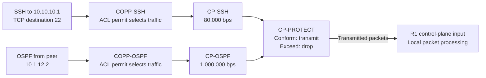
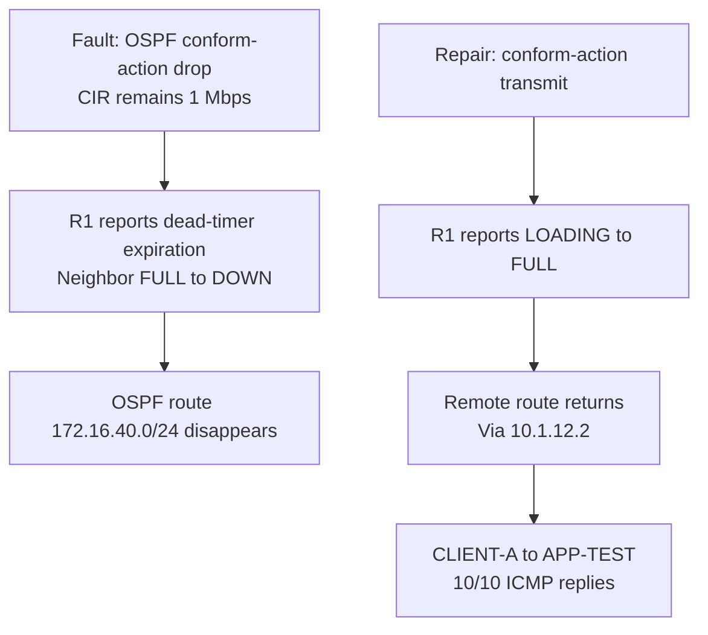

# CoPP operation — classify traffic, then inspect its treatment

These diagrams explain the saved policy and reported experiments. They are design illustrations, not packet captures or newly executed tests.

**Quick navigation:** [Classification](#separate-classification-from-action) · [SSH rate](#interpret-the-ssh-rate-experiment) · [OSPF dependency](#connect-routing-control-to-endpoint-reachability)

## Separate classification from action

The ACLs are classification criteria referenced by class maps. Their `permit` entries select packets for policing; they do not guarantee delivery. For example, the OSPF fault changed the selected class's action while leaving the ACL and CIR intact.

The SSH selector accepts any source to **10.10.10.1:22**; it is not a trusted-source allowlist. The OSPF selector matches traffic from **10.1.12.2** without restricting its destination to a particular multicast address. Unmatched packets do not become an implicit interface-ACL deny merely because these class selectors did not match. No separate class-default policer is configured in this lab.

## Interpret the SSH rate experiment

A policer evaluates traffic against a rate and burst allowance, then applies the configured action. CIR is in **bits per second**; the temporary **1,500-byte** burst value has a different unit. Policing drops excess traffic here rather than buffering it for later delivery.

The handoff reports exceed totals rising to **7**, then **10**, during the **8-kbps** experiment and a subsequent closed SSH attempt. This supports a disruption associated with the restrictive policer; no packet trace identifies the exact packets that caused that attempt to close.

After restoring **80 kbps**, the comparison was **119 → 185 matched**, **109 → 175 conformed**, and **10 → 10 exceeded**. Successful privilege-15 authentication accompanied **66 additional conforming packets and zero additional exceeded packets**. These are observations for that comparison, not a general rate-sizing recommendation. The saved final policy does not specify a burst value. [SSH evidence](verification/ssh-policing.md)

## Connect routing control to endpoint reachability

The final client-to-application packets are routed transit traffic. Their normal forwarding path is **CLIENT-A → R1 → R2 → APP-TEST**, separate from the local SSH and OSPF traffic selected for CoPP. OSPF supplies the remote route, so a control-plane fault can affect this path without the SSH or OSPF class directly filtering the ICMP flow.

`Conformed` describes the policer's classification of traffic relative to its parameters; the configured conform action can still be **drop**. Historical conform totals spanning policy changes do not establish how many packets the temporary fault dropped. The reported adjacency events and route removal/reinstallation establish the observed service impact and recovery. No exact convergence interval was supplied. [OSPF evidence](verification/ospf-protection.md) · [OSPF case](troubleshooting/02-ospf-conform-action.md)

[Overview](README.md) · [Topology](topology.md) · [Configurations](configs/README.md) · [Verification matrix](verification/README.md) · [Evidence scope](scope.md)
