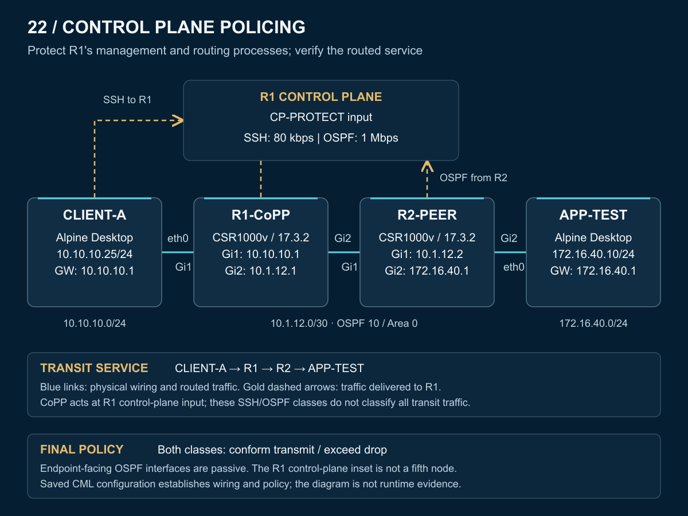

# CoPP topology

The diagram is derived from the saved CML wiring and configuration. It is an engineering illustration, not a captured runtime view. [Full-size PNG](topology.png) · [SVG](topology.svg) · [Sanitized CML export](CML-LAB.yaml)

## Devices and links

| Device | Interface | Address | Connection |
|---|---|---|---|
| CLIENT-A | eth0 | `10.10.10.25/24` | R1 Gi1; default gateway `10.10.10.1` |
| R1-CoPP | Gi1 | `10.10.10.1/24` | CLIENT-A eth0 |
| R1-CoPP | Gi2 | `10.1.12.1/30` | R2 Gi1 |
| R2-PEER | Gi1 | `10.1.12.2/30` | R1 Gi2 |
| R2-PEER | Gi2 | `172.16.40.1/24` | APP-TEST eth0 |
| APP-TEST | eth0 | `172.16.40.10/24` | R2 Gi2; default gateway `172.16.40.1` |

The four nodes are two CSR1000v routers using IOS XE 17.3.2 and two Alpine Desktop endpoints. Only three physical links are present; the R1 control-plane inset is a logical role within R1, not a fifth device.

## Control plane and transit traffic

| Traffic | Role in the lab |
|---|---|
| CLIENT-A SSH to `10.10.10.1:22` | Terminates on R1; classified by `COPP-SSH` into `CP-SSH` |
| OSPF from R2 `10.1.12.2` | Reaches R1's routing process; classified by `COPP-OSPF` into `CP-OSPF` |
| CLIENT-A to APP-TEST | Routed through R1 and R2; final 10/10 ping was the reported end-to-end regression |

R1 router ID is `1.1.1.1`; R2 router ID is `2.2.2.2`. OSPF process 10 uses Area 0 across `10.1.12.0/30`. R1 Gi1 and R2 Gi2 are passive OSPF interfaces: their networks are advertised without forming endpoint-facing adjacencies.

The final input policy is attached under R1 `control-plane`, not as an interface ACL on the transit links. The OSPF fault removed R1's route to APP-TEST's network; restoring the conform action restored adjacency and routing before the final connectivity check.

[Overview](README.md) · [Operation](operation.md) · [Configurations](configs/README.md) · [Verification](verification/README.md) · [Troubleshooting](troubleshooting/README.md)
