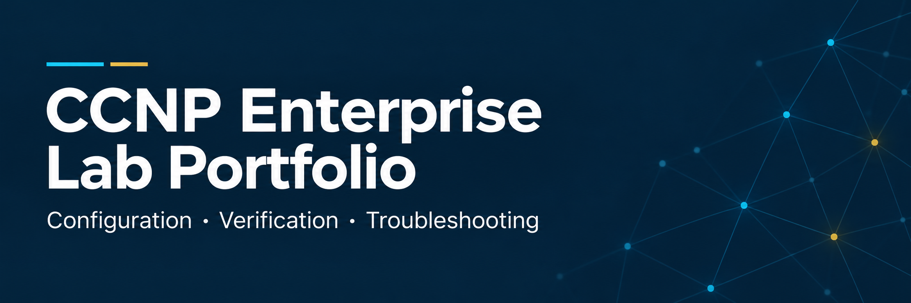

# CCNP Enterprise Lab Portfolio

Hands-on enterprise networking in **Cisco Modeling Labs (CML)**: routing, VRF segmentation, GRE/IPsec tunneling, traffic policy, multicast, switching, gateway redundancy, address translation, DHCP, time synchronization, and device-local automation.

I built these labs to understand how networks behave when configurations change and components fail. Each section connects the intended design to troubleshooting decisions, targeted repairs, and the results recorded on the devices.

**Quick navigation:** [Featured cases](#start-with-these-three-cases) · [Modules](#explore-the-modules) · [Reading guide](#how-to-review-the-work) · [CML exports](#reuse-a-lab) · [Evidence scope](#evidence-scope)

## Start with these three cases

### Restore outside access through multiple NAT faults

**Problem:** Two clients could not reach an outside server. Four starting faults affected classification, source eligibility, return routing, and pool capacity; a temporary pool-name typo added another checkpoint.

**Recorded result:** **5/5 replies from each client**, with two different translated addresses allocated in the same table.

[Read the NAT case](08-NAT/troubleshooting/incident-01-external-connectivity-outage.md) · [Inspect the final evidence](08-NAT/verification/incident-01-final.txt)

### Diagnose an active gateway that cannot forward upstream

**Problem:** A client lost all ten probes after its gateway's upstream link failed, although the gateway remained HSRP Active.

**Recorded result:** Tracking enabled alternate-gateway takeover, followed by **10/10 replies**. Recovery testing also exposed gateway reclamation before OSPF readiness.

[Read the HSRP case](07-FHRP/troubleshooting/scenario-1-hsrp-upstream-black-hole.md) · [Inspect alternate-path verification](07-FHRP/verification/hsrp-tracking/PC-A-ping-and-traceroute-tracking-failover.txt)

### Repair an OSPF adjacency when ping still works

**Problem:** O2 received all five ping replies from O4, but OSPF stalled in `EXSTART`. Physical interfaces reported MTU 1500; an IP-specific check revealed a one-sided 1400-byte override.

**Recorded result:** Removing the override restored **FULL adjacency on both routers**.

[Read the OSPF case and evidence](02-OSPF/troubleshooting/scenario-1-ospf-mtu-exstart-exchange.md)

## Explore the modules

### Routing

| Module | Engineering focus | Suggested case |
|---|---|---|
| [01 — EIGRP](01-EIGRP/README.md) | Backup eligibility, failover, and route policy | [A qualified backup takes over](01-EIGRP/troubleshooting/scenario-1-feasible-successor-promotion.md) |
| [02 — OSPF](02-OSPF/README.md) | Neighbor synchronization and routing across areas | [A missing route with healthy neighbors](02-OSPF/troubleshooting/scenario-3-abr-route-filtering-control-plane.md) |
| [03 — BGP](03-BGP/README.md) | Peering, next-hop resolution, and advertisement policy | [A healthy session with an unusable path](03-BGP/troubleshooting/scenario-2-ibgp-next-hop-reachability.md) |

### Switching and gateway redundancy

| Module | Engineering focus | Suggested case |
|---|---|---|
| [04 — STP](04-STP/README.md) | Loop prevention, root placement, and link protection | [Member failure versus bundle failure](04-STP/troubleshooting/11-lacp-negotiation-and-member-failure.md) |
| [05 — MSTP](05-MSTP/README.md) | VLAN-group paths and protocol-boundary protection | [Inconsistent root information blocks a boundary](05-MSTP/troubleshooting/scenario-6-pvst-sim-inferior-vlan/README.md) |
| [06 — EtherChannel](06-ETHERCHANNEL/README.md) | Link aggregation, resilience, and forwarding checks | [A VLAN mismatch suspends one member](06-ETHERCHANNEL/troubleshooting/case-01-vlan-mask-mismatch.md) |
| [07 — FHRP](07-FHRP/README.md) | Gateway redundancy, upstream tracking, and recovery | [Successful traffic conceals a version mismatch](07-FHRP/troubleshooting/scenario-2-hsrp-version-mismatch.md) |

### Network services, policy, and multicast

| Module | Engineering focus | Suggested case |
|---|---|---|
| [08 — NAT/PAT](08-NAT/README.md) | Translation, address sharing, and integrated faults | [Restore access after PAT migration](08-NAT/troubleshooting/incident-02-pat-migration.md) |
| [09 — DHCP](09-DHCP/README.md) | Address assignment, relay, and lease-state diagnosis | [A valid address without remote access](09-DHCP/troubleshooting/02-incorrect-default-gateway.md) |
| [10 — NTP](10-NTP/README.md) | Time hierarchy, source failover, and service-specific diagnosis | [Ping works while time updates stop](10-NTP/troubleshooting/03-acl-udp123.md) |
| [11 — PBR](11-PBR/README.md) | Selective forwarding, policy logic, and next-hop recovery | [A next-hop route remains while the policy path changes](11-PBR/troubleshooting/02-next-hop-failure.md) |
| [12 — Multicast](12-MULTICAST/README.md) | RP discovery, IGMP/SSM membership, BIDIR role changes, and path diagnosis | [OSPF reaches the BSR, but RP discovery stops](12-MULTICAST/PIM-SM/troubleshooting/07-bsr-propagation.md) |

### Segmentation and tunneling

| Module | Engineering focus | Suggested case |
|---|---|---|
| [13 — VRF](13-VRF/README.md) | Overlapping networks, separate forwarding state, and selective shared access | [An installed route with an unresolved next hop](13-VRF/troubleshooting/01-bad-next-hop.md) |
| [14 — GRE/IPsec and IKEv2 VTI](14-GRE-IPsec-Tunneling/README.md) | Policy-based protection, route-based tunneling, and OSPF across both designs | [Direct OSPF and 10/10 private replies over VTI](14-GRE-IPsec-Tunneling/verification/07-vti.md) |

### Device automation

| Module | Engineering focus | Suggested case |
|---|---|---|
| [15 — EEM](15-EEM/README.md) | Automated diagnostics, timer/CLI events, and detector matching | [A registered policy misses the actual syslog event](15-EEM/troubleshooting/incorrect-syslog-pattern.md) |

## How to review the work

**Predict → configure → verify → explain → break → diagnose → repair → capture evidence**

Start with a module's overview or featured case, then follow its supporting guides. Multicast groups these guides under [PIM-SM](12-MULTICAST/PIM-SM/README.md), [IGMPv2/v3](12-MULTICAST/IGMPv2-v3/README.md), and [BIDIR-PIM](12-MULTICAST/BIDIR-PIM/README.md):

| Directory | Purpose |
|---|---|
| `configs/` | Device roles, important settings, and configuration source or reconstruction status |
| `verification/` | Captured output, interpretation, and links to individual evidence files |
| `troubleshooting/` | Symptoms, diagnosis, corrective actions, and available recovery checks |

The cases distinguish configured intent, observed device state, and tested service outcomes. A healthy routing session, active gateway, or assigned address can coexist with a forwarding problem.

## Reuse a lab

| CML export | Saved state | Configuration guide |
|---|---|---|
| [STP](04-STP/CCNP_MASTERCLASS_STP.yaml) | Switching checkpoint | [STP settings](04-STP/configs/README.md) |
| [MSTP](05-MSTP/CCNP_MASTERCLASS_MSTP.yaml) | Region and boundary checkpoint | [MSTP settings](05-MSTP/configs/README.md) |
| [EtherChannel](06-ETHERCHANNEL/CML-LAB.yaml) | Link-aggregation checkpoint | [Bundle settings](06-ETHERCHANNEL/configs/README.md) |
| [NTP](10-NTP/CCNP_MASTERCLASS_LAB_September_18th.yaml) | Earlier hierarchy checkpoint | [Later source changes](10-NTP/configs/README.md) |
| NAT: [Incident 01](08-NAT/configs/incident-01-original.yaml) / [Incident 02](08-NAT/configs/incident-02-original.yaml) | Original fault states | [Repairs and final configurations](08-NAT/configs/README.md) |
| [Multicast BSR](12-MULTICAST/PIM-SM/configs/PIM-SM_BSR_September_24th.yaml) | Intermediate seven-node checkpoint | [Completion steps](12-MULTICAST/PIM-SM/configs/bsr.md) |
| [VRF](13-VRF/configs/CCNP_VRF_Sept_27th-baseline.yaml) | Original three-router isolation stage | [Shared-service additions](13-VRF/configs/README.md) |
| [Section 14 VTI](14-GRE-IPsec-Tunneling/configs/IKEv2-VTI-CML-sanitized.yaml) | Saved three-router IKEv2 VTI and OSPF checkpoint; key sanitized | [VTI settings and provenance](14-GRE-IPsec-Tunneling/configs/vti.md) |
| [EEM](15-EEM/CML-LAB.yaml) | Completed two-router lab with two retained applets; device-specific material sanitized | [Retained and temporary applets](15-EEM/configs/README.md) |

Exports preserve different lab stages. Read the linked guide for configuration provenance and import requirements. Other modules provide extracts or reconstructed configurations with their source explained in the guides.

## Evidence scope

Cases distinguish captured output, recorded observations and configuration analysis. Reconstructed commands and measurement limits are identified alongside the relevant evidence. Diagrams explain the designs; linked CLI captures establish the recorded behavior.
