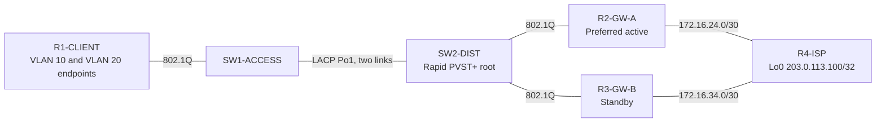

# Lab 19A — Integrated Enterprise Network

I built a two-VLAN enterprise LAN in Cisco Modeling Labs and connected it to a simulated ISP through two redundant gateways. The lab tested whether a new flow could reach an external endpoint after an HSRP gateway change, whether the backup performed its own PAT, and whether it enforced the same user policy. The lab record reports that all three behaviors were verified. R4 supplied the ISP routing and test endpoint inside CML. The topology had no Internet connection.

**Quick navigation** · [Results](#recorded-results) · [Topology](topology.md) · [Operation](operation.md) · [Configurations](configs/README.md) · [Verification matrix](verification/README.md) · [Troubleshooting](troubleshooting/README.md) · [Lessons learned](lessons-learned.md) · [Evidence scope](scope.md)

## Recorded results

| Engineering question | Reported outcome |
|---|---|
| Did the campus switching path converge? | LACP Port-channel1 operated on both switches, and SW2 was verified as the Rapid PVST+ root. |
| Could each gateway reach the simulated outside network? | Both gateways formed FULL Area 0 OSPF adjacencies with R4 and learned `203.0.113.100/32`. |
| Did the standby gateway take over and translate new traffic? | The HSRPv2 group 10 active role moved from R2 to R3. R1 reached the loopback through both gateways in separate tests. The reported inside global addresses were `172.16.24.1` on R2 and `172.16.34.1` on R3. R2 later resumed the active role through preemption. |
| Did the user policy survive the gateway change? | `USERS-FILTER` denied five VLAN 10 ICMP echo requests on each gateway in separate tests. |
| Could VLAN 20 reach the loopback? | A separate test selected the VLAN 20 gateway using a temporary host route. The record reports permitted reachability and a PAT translation. |

The source handoff supplies these outcomes as reported observations. The verification matrix maps them to commands for future capture. The complete CML checkpoint remains private pending redistribution clearance. [Verification matrix](verification/README.md) · [Evidence scope](scope.md)

## Business scenario and objectives

A campus LAN with separate user and server segments needs a stable default gateway, a redundant routed exit, and consistent policy during gateway maintenance or failure. This lab modeled that requirement with one client router emulating hosts on both VLANs, two switches carrying tagged traffic, and two gateways with individual uplinks to a common provider router. The implementation verified the switching, routing, translation, and policy dependencies before testing their combined behavior during a role change.

## Network design

| Devices | Role | Addressing |
|---|---|---|
| R1-CLIENT | IOSv endpoint simulator | VLAN 10 `10.10.10.10/24`, VLAN 20 `10.10.20.20/24` |
| SW1-ACCESS and SW2-DIST | Layer 2 trunking and aggregation | VLAN 10 USERS and VLAN 20 SERVERS carried through Port-channel1 |
| R2-GW-A and R3-GW-B | IOSv first-hop redundancy, PAT, and filtering | VLAN 10 VIP `10.10.10.1`, VLAN 20 VIP `10.10.20.1`. WAN/PAT addresses `172.16.24.1` and `172.16.34.1` respectively. |
| R4-ISP | IOSv simulated ISP and external endpoint | `172.16.24.2/30`, `172.16.34.2/30`, loopback `203.0.113.100/32` |

[Detailed interface and link map](topology.md) · [Implementation examples](configs/README.md)

## Implementation decisions

| Technology | Implementation |
|---|---|
| VLANs and IEEE 802.1Q | The switch trunks allow VLANs 10 and 20. R1 and both gateways terminate the tagged VLANs on separate router subinterfaces. |
| LACP and Rapid PVST+ | Both switches actively negotiate the two-member LACP Port-channel1. SW2 has the lower configured bridge priority, 4096 versus 8192 on SW1, for both VLANs. |
| First-hop redundancy | HSRPv2 groups 10 and 20 use the same VIPs on both gateways. R2 has priority 110 and R3 uses the default 100. Preemption is configured on both routers. |
| Upstream reachability | OSPFv2 process 10 runs in Area 0 on the two provider links. R4 advertises its test loopback. The campus VLAN subinterfaces do not participate. |
| Address translation | Each gateway overloads its own WAN interface address. NAT selection ACL 10 includes both campus subnets. Each router maintains its own dynamic translation state. |
| Security policy | Both gateways apply `USERS-FILTER` inbound on Gi0/0.10. The ACL denies VLAN 10 echo requests to R4’s test IP and permits other IP traffic. VLAN 20 uses a separate subinterface without this filter. |

The configuration guide connects each device role to selected implementation commands checked against the saved lab. [Configuration guide](configs/README.md)

## Failover and troubleshooting

The original sequence exercised VLAN 10 gateway failover, generated new traffic through R3, and verified R2’s return through preemption. Independent translation-table observations distinguished the active egress paths. The user policy was then checked on each gateway using the deny counter rather than a failed ping alone. A separate VLAN 20 test used a temporary host route for path selection before restoring R1’s VLAN 10 default route as the only saved static route. [Test sequence](verification/README.md#failover-and-policy-sequence) · [Troubleshooting cases](troubleshooting/README.md)

The design shares one distribution switch and one simulated provider. It has no HSRP uplink tracking or NAT state synchronization. The failover result establishes recovery for new traffic in the reported test. Continuous transport sessions, WAN-only failures, and failover timing remain unverified. Potential improvements include tracking the upstream path in HSRP, adding distribution and provider diversity, and measuring the effect of a gateway change on a long-lived flow. [Design limits and lessons](lessons-learned.md)

## Skills demonstrated and ENCOR relevance

The lab applies the CCNP Enterprise ENCOR v1.2 infrastructure and security topics for 802.1Q trunks, EtherChannel, Rapid PVST+, OSPFv2, NAT/PAT, first-hop redundancy, and IPv4 ACLs. Its distinguishing evidence is the cross-layer verification sequence: establish the Layer 2 path and OSPF route, identify the first-hop owner and translation address, then confirm the same filtering behavior under both owners.

[Integrated lab index](../README.md) · [Portfolio](../../README.md) · [Portfolio reading guide](../../READING-GUIDE.md)
