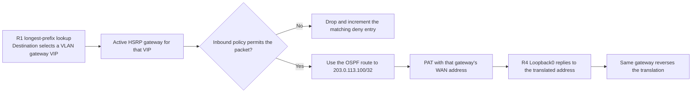

# Lab 19A packet paths

## Campus forwarding and gateway selection

R1 tags simulated user traffic with VLAN 10 and server traffic with VLAN 20. SW1 carries both VLANs over Port-channel1 to SW2. Rapid PVST+ treats the negotiated bundle as one logical link in each VLAN. SW2 has the lower configured bridge priority and was reported as the root. Both switches set Gi0/2 and Gi0/3 to LACP active mode.

The switches forward frames for each virtual gateway to the router holding the corresponding HSRP active role. Both VLANs use HSRPv2 and preemption. R2’s priority of 110 makes it preferred over R3’s default 100 while both gateways are available. A change to group 10 can be verified independently of group 20.

## Route and translation through the active gateway

| Forwarding choice | Routing and return path |
|---|---|
| R2 active | R2 learns the loopback through R4 at `172.16.24.2`. PAT sends permitted inside traffic using `172.16.24.1`. R4 returns replies on the directly connected `172.16.24.0/30` segment. |
| R3 active | R3 learns the loopback through R4 at `172.16.34.2`. PAT sends permitted inside traffic using `172.16.34.1`. R4 returns replies on the directly connected `172.16.34.0/30` segment. |

R4 advertises its loopback with OSPF Area 0. The campus VLANs have no OSPF configuration, and R4 can reply to the PAT addresses using connected routes. NAT selection ACL 10 matches both inside subnets after the ingress policy permits the packet.

## Consistent policy during a role change

R2 and R3 both attach `USERS-FILTER` inbound to their VLAN 10 subinterfaces. In the saved policy, an echo request from `10.10.10.0/24` to `203.0.113.100` matches the deny entry at the first routed hop and is dropped before PAT. The permitted VLAN 10 PAT tests exercised the translation path in a separate test state. The same echo probe should match the deny entry in the saved filtered checkpoint.

VLAN 20 traffic enters on Gi0/0.20 when R1 routes it through the VLAN 20 virtual gateway. The packet avoids the VLAN 10 ingress filter and can match the PAT selector. R1 has one global routing table. Choosing a VLAN 20 source address leaves the destination route unchanged unless the route itself selects the VLAN 20 next hop. The recorded exercise temporarily used a destination `/32` to isolate that route choice.

HSRP transfers ownership of the virtual gateway. The new active router establishes its own dynamic translations, using a different outside address. A successful new flow after failover and an established session’s ability to survive the role change are different tests.

[Overview](README.md) · [Topology](topology.md) · [Verification](verification/README.md) · [Troubleshooting](troubleshooting/README.md)
