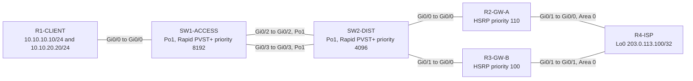

# Lab 19A topology

The diagram depicts the six nodes and seven physical links in the saved CML checkpoint. The two access-to-distribution links operate as one logical trunk when LACP converges. R2 and R3 are on the same two campus VLANs and use separate routed links to the same simulated ISP.

## Device inventory

| Device | Saved CML definition and image | Role |
|---|---|---|
| R1-CLIENT | `iosv`, `iosv-159-3-m3` | Emulates hosts using two IP subinterfaces on a single trunk. |
| SW1-ACCESS | `iosvl2`, `iosvl2-2020` | Aggregates the client trunk onto Port-channel1. |
| SW2-DIST | `iosvl2`, `iosvl2-2020` | STP root by priority design. Provides trunks to both gateways. |
| R2-GW-A | `iosv`, `iosv-159-3-m3` | Preferred HSRP gateway. PAT egress on the `172.16.24.0/30` link. |
| R3-GW-B | `iosv`, `iosv-159-3-m3` | Standby HSRP gateway. PAT egress on the `172.16.34.0/30` link. |
| R4-ISP | `iosv`, `iosv-159-3-m3` | OSPF peer for both gateways and hosts the external test IP on Loopback0. |

The lab handoff calls the switches IOL-L2. The supplied export specifies IOSvL2, so the inventory and import prerequisites follow the saved node and image definitions. [Evidence scope](scope.md)

## Physical links

| Link | Endpoint A | Endpoint B | Use |
|---|---|---|---|
| 1 | R1 Gi0/0 | SW1 Gi0/0 | 802.1Q client trunk. |
| 2 | SW1 Gi0/2 | SW2 Gi0/2 | LACP Port-channel1 member. |
| 3 | SW1 Gi0/3 | SW2 Gi0/3 | LACP Port-channel1 member. |
| 4 | SW2 Gi0/0 | R2 Gi0/0 | 802.1Q gateway trunk. |
| 5 | SW2 Gi0/1 | R3 Gi0/0 | 802.1Q gateway trunk. |
| 6 | R2 Gi0/1 | R4 Gi0/0 | OSPF Area 0 and R2 PAT outside. |
| 7 | R3 Gi0/1 | R4 Gi0/1 | OSPF Area 0 and R3 PAT outside. |

Every switch trunk and Port-channel1 allows VLANs 10 and 20. The CML graph has no separate management network or Internet connector.

## IP addressing

| Segment | Device or gateway | Interface | Address |
|---|---|---|---|
| VLAN 10 USERS | R1-CLIENT | Gi0/0.10 | `10.10.10.10/24` |
| VLAN 10 USERS | R2-GW-A | Gi0/0.10 | `10.10.10.2/24` |
| VLAN 10 USERS | R3-GW-B | Gi0/0.10 | `10.10.10.3/24` |
| VLAN 10 USERS | Shared HSRPv2 group 10 | Virtual IP | `10.10.10.1/24` |
| VLAN 20 SERVERS | R1-CLIENT | Gi0/0.20 | `10.10.20.20/24` |
| VLAN 20 SERVERS | R2-GW-A | Gi0/0.20 | `10.10.20.2/24` |
| VLAN 20 SERVERS | R3-GW-B | Gi0/0.20 | `10.10.20.3/24` |
| VLAN 20 SERVERS | Shared HSRPv2 group 20 | Virtual IP | `10.10.20.1/24` |
| R2–R4 WAN | R2-GW-A | Gi0/1 | `172.16.24.1/30` |
| R2–R4 WAN | R4-ISP | Gi0/0 | `172.16.24.2/30` |
| R3–R4 WAN | R3-GW-B | Gi0/1 | `172.16.34.1/30` |
| R3–R4 WAN | R4-ISP | Gi0/1 | `172.16.34.2/30` |
| Simulated external endpoint | R4-ISP | Loopback0 | `203.0.113.100/32` |

R2, R3, and R4 use OSPF process 10 with router IDs `2.2.2.2`, `3.3.3.3`, and `4.4.4.4`. OSPF participation is enabled on the two point-to-point physical links and R4’s loopback through interface configuration. The saved R1 default next hop is `10.10.10.1`.

[Overview](README.md) · [Operation](operation.md) · [Configurations](configs/README.md) · [Verification](verification/README.md)
