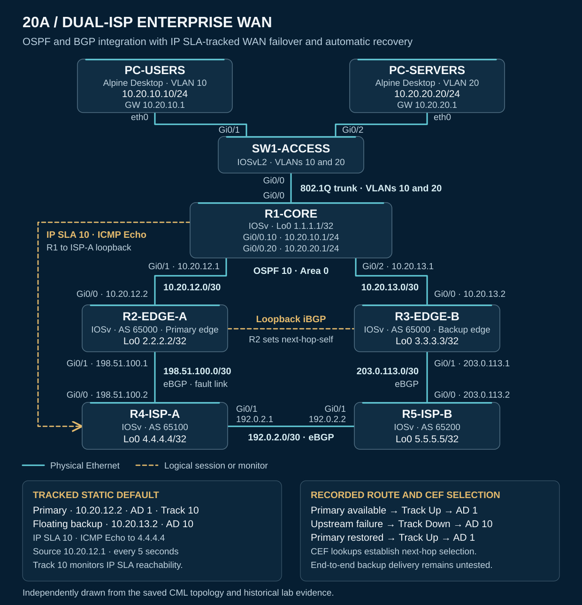

# Lab 20A — Dual-ISP Enterprise WAN

I configured an enterprise core to monitor an ISP-A loopback with IP SLA and track its primary static default. During a simulated upstream outage, the probe timed out and R1-CORE switched its default next hop to R3-EDGE-B toward ISP-B. When the probe recovered, R1 restored the preferred next hop. CLI excerpts from the original CML session show the route and CEF selections.

**Quick navigation:** [Topology](topology.md) · [Operation](operation.md) · [Configurations](configs/README.md) · [Verification](verification/README.md) · [Troubleshooting](troubleshooting/README.md) · [Lessons learned](lessons-learned.md) · [Evidence scope](scope.md)

## Lab objectives

- Establish provider eBGP and use loopback-based iBGP between the enterprise edges.
- Resolve missing ISP return routes and verify the two provider loopbacks from the enterprise core.
- Use IP SLA, object tracking, and floating static routing to handle an upstream failure automatically.
- Verify the active default in the routing table and its next hop in Cisco Express Forwarding (CEF).

## Lab design

This independently authored engineering diagram represents the saved CML topology.

[Port map and topology diagram](topology.md) · [PNG copy](topology.png) · [Selected implementation settings](configs/README.md)

Five Cisco IOSv routers form the WAN in Cisco Modeling Labs. R1-CORE connects to R2-EDGE-A and R3-EDGE-B in the AS 65000 enterprise. R2 peers with R4-ISP-A in AS 65100, and R3 peers with R5-ISP-B in AS 65200. The saved topology also includes an inter-provider link, an access switch, and two desktop endpoints. The documented outage test focuses on the five routers.

On R1, two static host routes keep the provider loopback tests on their respective edge paths. IP SLA 10 probes ISP-A loopback `4.4.4.4` from `10.20.12.1` every five seconds. Track 10 controls whether the primary default via `10.20.12.2` is eligible. The standby default via `10.20.13.2` has administrative distance 10.

## Results from the original CML session

| Phase | What the captured CLI shows |
|---|---|
| Return-path repair | R4 and R5 initially lacked routes to their respective ping sources. The added static routes appear in both tables, and R1 received **5/5** replies in each source-specific retest. [Route and ping excerpts](verification/return-path.md) |
| Baseline | Track 10 was Up with an OK return code. R1 installed the AD 1 default via `10.20.12.2`. [Baseline excerpt](verification/tracked-default.md#normal-tracked-default) |
| Primary WAN outage | R2 lost its R4 eBGP adjacency and the route to `4.4.4.4`. IP SLA timed out, Track 10 went Down, and R1 installed its AD 10 default via `10.20.13.2`. The CEF lookup selected Gi0/2. [Outage excerpts](verification/tracked-default.md#upstream-failure) |
| Recovery | IP SLA returned OK, Track 10 went Up, and R1 restored the AD 1 default via `10.20.12.2`. The CEF lookup selected Gi0/1. [Recovery excerpt](verification/tracked-default.md#primary-recovery) |

The loopback pings demonstrate reachability over the pinned host routes. The CEF lookups used different source interface addresses and establish R1's selected egress in each recorded state. End-to-end traffic through the backup default, Internet connectivity, and convergence duration remain unverified. [Evidence scope](scope.md)

## Final assessment

The [implementation notes](configs/README.md) trace the observed behavior to the saved CML settings. The complete checkpoint is retained privately pending redistribution clearance. A fresh CML import, boot, and runtime replay remain pending. [Replay procedure](verification/README.md#replay-and-capture)

[Integrated lab series](../README.md) · [Portfolio](../../README.md) · [Reading guide](../../READING-GUIDE.md)
