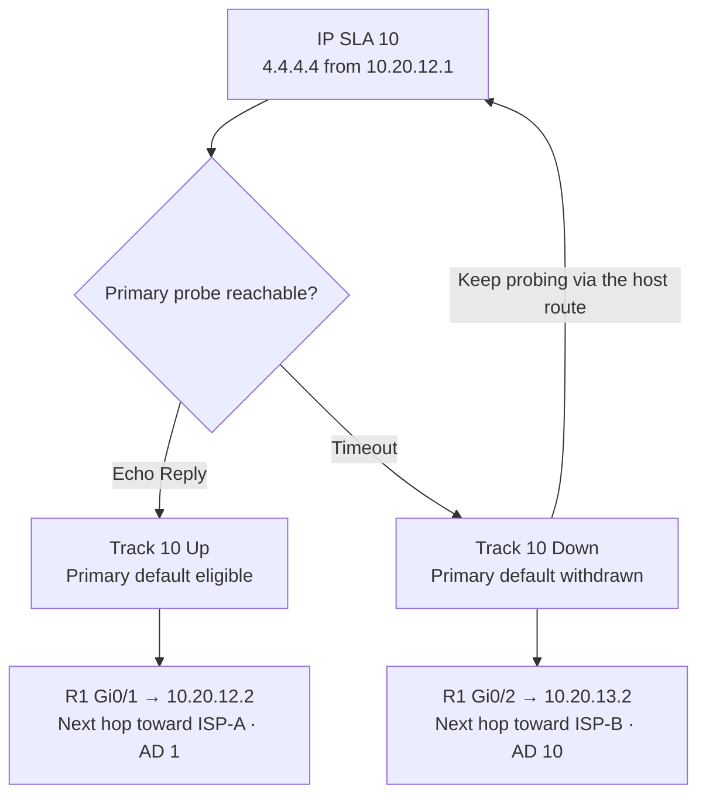

# How upstream reachability controls the default route

In the reported test, the link from R1 to its primary next hop `10.20.12.2` stayed up after R2 lost the ISP-A uplink. An unconditional AD 1 static default would remain eligible while that next hop stayed reachable. IP SLA 10 samples a destination beyond the provider handoff. R1 ties the preferred default to that result through Track 10. [Cisco IOS reliable static routing backup](https://www.cisco.com/c/en/us/td/docs/ios/dial/configuration/guide/15-mt/dia_15_mt_book/dia_rel_stc_rtg_bckup.pdf)

## Two routing decisions

1. **Route installation:** The two static defaults describe the same prefix, `0.0.0.0/0`. When Track 10 is Up and the next hop is reachable, the primary route at AD 1 wins over the eligible backup at AD 10. When the primary becomes ineligible, R1 can install the backup if its next hop is reachable.
2. **Packet forwarding:** R1 uses the most specific installed match. Its `4.4.4.4/32` route through R2 and `5.5.5.5/32` route through R3 take precedence over the default for those destinations. The host route keeps the probe pointed at R2 while that next hop remains reachable. [Cisco IOS route selection](https://www.cisco.com/c/en/us/support/docs/ip/enhanced-interior-gateway-routing-protocol-eigrp/8651-21.html)

## Dependencies downstream of R1

The host routes determine R1's first hop. R2 and R3 still need an onward route to the provider loopbacks, and the provider needs a return route to the probe source. R2's outage route lookup shows the loss of its route to `4.4.4.4`. The saved inter-provider link adds a possible alternate route through ISP-B. Only R2 sets `next-hop-self` in the edge iBGP configuration. If R2 receives an alternate path from R3 during a replay, compare its advertised next hop and the installed IP route to determine whether that path is usable. [Outage capture](verification/tracked-default.md#upstream-failure)

The five-second probe frequency is the configured scheduling interval. Detection and reversion depend on probe results, routing convergence, and forwarding updates. The preserved timestamps describe individual snapshots and leave switchover duration unmeasured.

[Overview](README.md) · [Configurations](configs/README.md) · [Verification](verification/README.md) · [Troubleshooting](troubleshooting/README.md)
