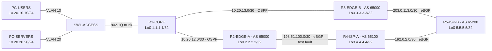

# Lab 20A topology and addressing

The saved CML checkpoint contains eight nodes and eight links. The diagram shows the physical wiring. The simulated provider loopbacks are the remote reachability targets, and R1's transit addresses are the sources covered by the ISP return routes.

## Physical wiring

| Side A | Side B | Function |
|---|---|---|
| R1-CORE Gi0/1 · `10.20.12.1/30` | R2-EDGE-A Gi0/0 · `10.20.12.2/30` | Enterprise primary transit |
| R1-CORE Gi0/2 · `10.20.13.1/30` | R3-EDGE-B Gi0/0 · `10.20.13.2/30` | Enterprise backup transit |
| R2-EDGE-A Gi0/1 · `198.51.100.1/30` | R4-ISP-A Gi0/0 · `198.51.100.2/30` | Primary ISP handoff and test fault |
| R3-EDGE-B Gi0/1 · `203.0.113.1/30` | R5-ISP-B Gi0/0 · `203.0.113.2/30` | Backup ISP handoff |
| R4-ISP-A Gi0/1 · `192.0.2.1/30` | R5-ISP-B Gi0/1 · `192.0.2.2/30` | Inter-provider eBGP |
| R1-CORE Gi0/0 | SW1-ACCESS Gi0/0 | Trunk carrying VLANs 10 and 20 |
| SW1-ACCESS Gi0/1 | PC-USERS eth0 · `10.20.10.10/24` | VLAN 10 access |
| SW1-ACCESS Gi0/2 | PC-SERVERS eth0 · `10.20.20.20/24` | VLAN 20 access |

The desktop gateways are on R1 Gi0/0.10 (`10.20.10.1/24`) and Gi0/0.20 (`10.20.20.1/24`). Those subinterfaces and the routed core-to-edge links participate in OSPF 10, Area 0, with passive access subinterfaces. OSPF carries the edge loopbacks for the logical R2–R3 iBGP session.

The saved image definitions are IOSv `iosv-159-3-m3` on the five routers, IOSvL2 `iosvl2-2020` on SW1, and desktop `desktop-3-13-2-xfce` on both endpoints.

[Overview](README.md) · [Routing and failover operation](operation.md) · [Configurations](configs/README.md) · [Verification](verification/README.md)
