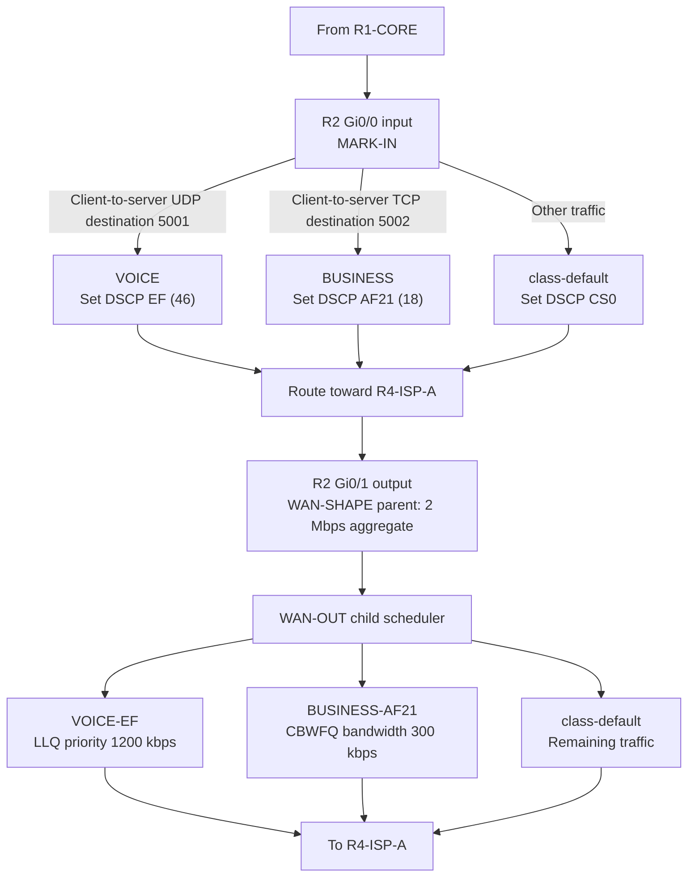

# Lab 20B QoS policy architecture

The final policy applies to PC-CLIENT traffic traversing R2-EDGE-A toward PC-SERVER. Modular QoS CLI (MQC) class maps identify the traffic, policy maps define treatment, and interface service-policy commands apply that treatment in the specified direction.

## Ingress classification and marking

The `VOICE-TRAFFIC` and `BUSINESS-TRAFFIC` ACLs match both host addresses and the exact transport protocol and destination port. Their permit entries act as MQC match criteria. `MARK-IN` assigns DSCP so that the output policy can classify by a consistent header value. The class named `VOICE` carried synthetic iPerf UDP traffic for this exercise.

## Egress scheduling and rate controls

| Mechanism | Responsibility in this design |
|---|---|
| LLQ | `priority 1200` gives EF traffic strict priority during congestion, with a configured 1,200-kbps priority allocation and an associated congestion-time rate limit on supported IOS implementations. |
| CBWFQ | `bandwidth 300` specifies a 300-kbps minimum allocation under congestion for AF21 traffic. The class can use available capacity above that allocation. |
| Parent shaping | `shape average 2000000` targets a 2,000,000-bps average service rate across the aggregate. Shaping buffers traffic for later transmission when queue capacity allows. |
| Child scheduling | `service-policy WAN-OUT` brings the EF, AF21, and default scheduling classes under the parent shaper. The child selects how the shaped capacity is allocated when traffic competes. |
| Temporary policing | The earlier `VOICE` test used a 512,000-bps rate with a 16,000-byte committed burst. Its exceed action discarded packets immediately. Those settings were removed from the final configuration. |

The scheduling allocations describe intended treatment at the egress policy. Receiver throughput also depends on offered load, queues, endpoints, and forwarding capacity along the path. [Cisco IOS priority versus bandwidth](https://www.cisco.com/c/en/us/support/docs/quality-of-service-qos/qos-packet-marking/10100-priorityvsbw.html) · [Cisco policing and shaping comparison](https://www.cisco.com/c/en/us/support/docs/quality-of-service-qos/qos-policing/19645-policevsshape.html)

## Implementation sequence

1. Verify both endpoint networks and the preferred static routes. Confirm that the flow traverses R2's two policy interfaces.
2. Define both ACL matches and apply `MARK-IN` on the enterprise-facing ingress. Test the UDP and TCP flows individually and compare each class counter with its baseline.
3. Apply the WAN queue policy and compare concurrent runs. For the final hierarchy, invoke `WAN-OUT` under the `WAN-SHAPE` parent and attach the parent to the ISP-facing egress.
4. Compare both policy directions and the endpoint results. The [policing experiment](verification/policing.md) and [DSCP mismatch case](troubleshooting/README.md) retain the reported intermediate checks and final recovery separately.

[Overview](README.md) · [Configuration extracts](configs/README.md) · [Verification walkthrough](verification/README.md) · [Study notes](lessons-learned.md)
