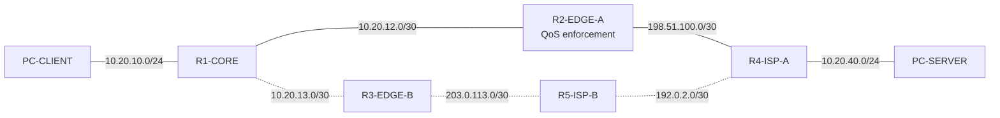

# Lab 20B topology and addressing

The saved topology connects five IOSv nodes (`iosv-159-3-m3`) and two Alpine Desktop nodes (`desktop-3-13-2-xfce`). Solid links mark the preferred client-to-server path. Dashed links mark physical links on the alternate path to R4. The diagram and port table were checked against the original interface and link definitions. [Evidence scope](scope.md)

## Routed links

| Segment | First endpoint | Second endpoint |
|---|---|---|
| Client LAN `10.20.10.0/24` | PC-CLIENT `eth0` · `10.20.10.10/24` | R1-CORE `Gi0/0` · `10.20.10.1/24` |
| Core to edge A `10.20.12.0/30` | R1-CORE `Gi0/1` · `10.20.12.1/30` | R2-EDGE-A `Gi0/0` · `10.20.12.2/30` |
| Core to edge B `10.20.13.0/30` | R1-CORE `Gi0/2` · `10.20.13.1/30` | R3-EDGE-B `Gi0/0` · `10.20.13.2/30` |
| Edge A to ISP A `198.51.100.0/30` | R2-EDGE-A `Gi0/1` · `198.51.100.1/30` | R4-ISP-A `Gi0/0` · `198.51.100.2/30` |
| Edge B to ISP B `203.0.113.0/30` | R3-EDGE-B `Gi0/1` · `203.0.113.1/30` | R5-ISP-B `Gi0/0` · `203.0.113.2/30` |
| ISP interconnect `192.0.2.0/30` | R4-ISP-A `Gi0/1` · `192.0.2.1/30` | R5-ISP-B `Gi0/1` · `192.0.2.2/30` |
| Server LAN `10.20.40.0/24` | R4-ISP-A `Gi0/2` · `10.20.40.1/24` | PC-SERVER `eth0` · `10.20.40.10/24` |

PC-CLIENT uses `10.20.10.1` as its default gateway. PC-SERVER uses `10.20.40.1`.

| Router | Role | Loopback0 |
|---|---|---|
| R1-CORE | Client LAN gateway and forward-path selection | `1.1.1.1/32` |
| R2-EDGE-A | Primary branch edge and QoS enforcement | `2.2.2.2/32` |
| R3-EDGE-B | Alternate branch edge | `3.3.3.3/32` |
| R4-ISP-A | Server gateway and return-path selection | `4.4.4.4/32` |
| R5-ISP-B | Alternate transit to R4 | `5.5.5.5/32` |

## Policy location

On R2-EDGE-A, traffic from R1 is classified and marked as it enters `Gi0/0`. The resulting DSCP selects the queue as traffic leaves `Gi0/1` for R4. The alternate path through R3 and R5 bypasses R2. The application tests in the lab record concern R2's primary-path policy. [Policy architecture](operation.md) · [Saved route choices](configs/README.md#static-routing)

[Overview](README.md) · [Verification](verification/README.md) · [Evidence scope](scope.md)
