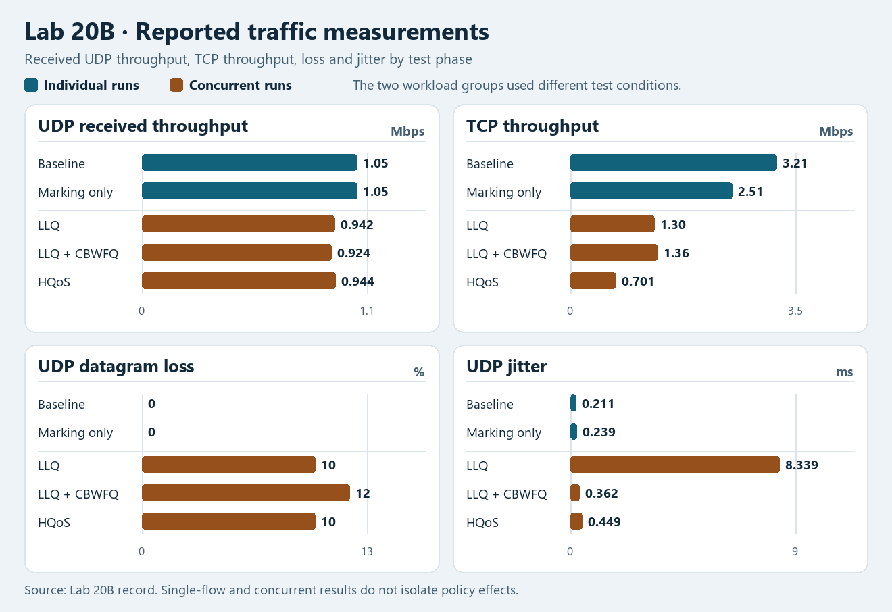

# Lab 20B traffic performance

The five-stage comparison comes from the original lab record. Selected operational captures for the HQoS run appear below. The baseline and marking-only rows are **individual** UDP and TCP tests. The last three rows are **concurrent** UDP and TCP tests. Compare workload and policy stage together because both changed over the course of the lab.

| Policy stage | Workload | UDP received throughput | UDP loss | UDP jitter | TCP throughput |
|---|---|---:|---:|---:|---:|
| Baseline | Individual tests | 1.05 Mbps | 0% | 0.211 ms | 3.21 Mbps |
| Marking only | Individual tests | 1.05 Mbps | 0% | 0.239 ms | 2.51 Mbps |
| LLQ | Concurrent traffic | 942 Kbps | 10% | 8.339 ms | 1.30 Mbps |
| LLQ + CBWFQ | Concurrent traffic | 924 Kbps | 12% | 0.362 ms | 1.36 Mbps |
| HQoS | Concurrent traffic | 944 Kbps | 10% | 0.449 ms | 701 Kbps |



The recorded LLQ and LLQ + CBWFQ runs show different jitter, loss, and TCP rates. Individual rows do not isolate the causal effect of a single policy. Traffic competition, IOSv forwarding limits, and the test conditions all affect the endpoint results. [Platform and measurement limits](../scope.md#platform-and-measurement-limits)

## Final HQoS counters

**Captured CLI excerpt — original CML lab session, R2-EDGE-A, `show policy-map interface GigabitEthernet0/1` after concurrent traffic.**

```text
Service-policy output: WAN-SHAPE

  Class-map: class-default (match-any)
    3148 packets, 4708940 bytes
    5 minute offered rate 86000 bps, drop rate 0000 bps
    Match: any
    Queueing
    queue limit 64 packets
    (queue depth/total drops/no-buffer drops) 0/0/0
    (pkts output/bytes output) 2833/4233838
    shape (average) cir 2000000, bc 8000, be 8000
    target shape rate 2000000

    Service-policy : WAN-OUT
```

**Captured iPerf excerpts — original concurrent UDP and TCP traffic tests.**

```text
[  1] 0.00-20.02 sec  2.51 MBytes  1.05 Mbits/sec
[  1] Sent 1788 datagrams
[  1] Server Report:
[ ID] Interval       Transfer     Bandwidth        Jitter   Lost/Total Datagrams
[  1] 0.00-20.02 sec  2.25 MBytes   944 Kbits/sec   0.449 ms 180/1787 (10%)
```

```text
[  1] 0.00-20.53 sec  1.72 MBytes   701 Kbits/sec
```

**Associated child-policy and interface counter summary — historical lab record.** The parent policy and iPerf excerpts above are verbatim. The values below accompany the supplied excerpts as a counter summary.

| Check | Value |
|---|---:|
| Voice classified | 1,787 packets |
| Voice priority queue output | 1,607 packets |
| Business classified | 1,329 packets |
| Business queue output | 1,194 packets |
| Business bandwidth allocation | 300 kbps |
| Priority bandwidth exceed drops | 0 |
| Individual queue drops | 0 |
| Interface output drops | 155 → 575 |

The voice classification-to-output difference was 180 packets, matching the 180 missing datagrams in the captured iPerf report. The reported interface output-drop total increased by 420. These counts leave the drop mechanism unresolved. The captured 2-Mbps figure is the parent target. The available test provides no independent measurement of shaping precision or scheduling guarantees.

[Verification matrix](README.md) · [Policing experiment](policing.md) · [Policy architecture](../operation.md)
